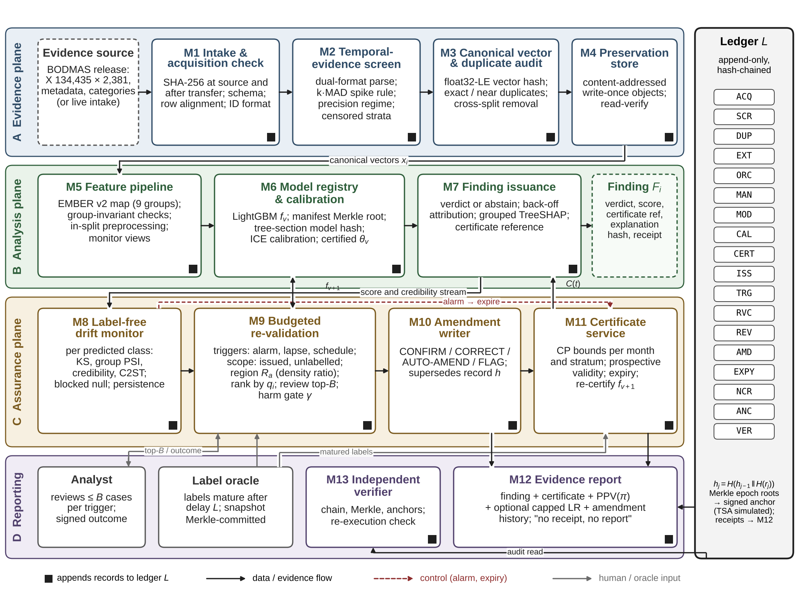

# TRACE-PE

**A framework for evidence collection and analysis of malware activities using machine learning — Windows PE, EMBER v2 static features, BODMAS.**

TRACE-PE treats every machine-learning verdict about a Windows PE sample as a piece of evidence. Each finding is bound by SHA-256 to its sample, its canonical feature vector, the model that produced it (tree-section hash), the threshold and its certification data, a time-indexed error certificate and an exact explanation, and is written to an append-only, hash-chained evidence ledger with Merkle epochs and Ed25519-signed anchors. An independent verifier can re-check the chain and the stored objects and re-execute any finding bit for bit.

This repository contains the code behind the paper *"A Framework for Evidence Collection and Analysis of Malware Activities using Machine Learning Techniques"*: the evidence layer, the temporal-evidence screen, the 17-detector model zoo, Clopper–Pearson-certified thresholds and certificates, conformal abstention, the label-free drift monitor, the assurance-plane simulation with its pre-registered kill criteria, the attribution leg, grouped TreeSHAP explanations, the EMBER-2018 corroboration, the code that renders every table and figure of the results chapter, and a test suite.

> **Scope.** Static EMBER v2 features of Windows PE files only. No binary is parsed or executed; the pipeline works on the feature vectors published with the datasets. Dynamic, Android, network/IoT and memory-forensics claims are out of scope.



---

## Contents

- [What the framework does](#what-the-framework-does)
- [Installation](#installation)
- [Data](#data)
- [Quick start: synthetic smoke test](#quick-start-synthetic-smoke-test)
- [Reproducing the paper](#reproducing-the-paper)
- [Paper item → script → output](#paper-item--script--output)
- [Evidence ledger and verification](#evidence-ledger-and-verification)
- [Configuration](#configuration)
- [Repository layout](#repository-layout)
- [Tests](#tests)
- [Status and limitations](#status-and-limitations)
- [Citation](#citation) · [License](#license) · [Acknowledgements](#acknowledgements)

---

## What the framework does

Thirteen modules in four planes surround one ledger (paper Fig. 1; `figures/design/`):

| Plane | Module | Code |
|---|---|---|
| Evidence | M1 intake and acquisition check (digests at source and after transfer, schema, row alignment, identifier format) | `tracepe.data.bodmas`, `scripts/e00_intake.py` |
| | M2 temporal-evidence screen (dual-format timestamps, common window, k·MAD spike rule, precision regime, strata) | `tracepe.evidence.screen` |
| | M3 canonical vectors and duplicate audit | `tracepe.evidence.hashing`, `scripts/e00_intake.py` |
| | M4 preservation store, oracle snapshot root, epoch Merkle roots, anchors | `tracepe.evidence.store`, `tracepe.evidence.merkle`, `tracepe.evidence.ledger` |
| | M5 feature pipeline (EMBER v2 group map, intake invariants, leakage-safe preprocessing) | `tracepe.features`, `tracepe.data.ember` |
| Analysis | M6 model registry and calibration (tree-section identity, CP-certified thresholds, ICE credibility) | `tracepe.models`, `tracepe.decision` |
| | M7 finding issuance (verdict / abstention / screening-only, grouped TreeSHAP, receipts) | `scripts/e09_explain_issue.py` |
| Assurance | M8 label-free drift monitor (KS, PSI, credibility, Page–Hinkley, C2ST; blocked null) | `tracepe.drift`, `scripts/e06_monitor.py` |
| | M9–M11 budgeted re-validation, amendments, certificates, reconciliation | `tracepe.assurance.simulation`, `tracepe.decision.certificates` |
| Reporting | M12 evidence report ("no receipt, no report") | `scripts/report_finding.py` |
| | M13 independent verifier (V1 chain, V2 objects, V3 re-execution) | `scripts/verify_ledger.py`, `scripts/e09_explain_issue.py` |

Stage labels S6–S10 appear in the pre-registration and in the docs: S6 = critical review that fixed the kill criteria, S7 = framework design and its probes on the real data, S8 = analytical model (equations), S9 = experimental harness, S10 = evaluation.

The evaluation follows a protocol that was **pre-registered before any test-period computation** (`docs/PREREGISTRATION.md`, SHA-256 `c783f8c4b160721867ff0c3903d4212efef90786cab88c2437addc2eaec199c4`, recorded as the `PREREG` record of the ledger): TESSERACT-style temporal split (train Aug–Nov 2019, calibrate Dec 2019, test Jan–Sep 2020), metrics at stated deployment prevalence, 16 falsifiable predictions and the kill criteria that decide which claims survive (`scripts/e15_register.py`).

## Installation

Python ≥ 3.10 (developed and tested with Python 3.13; `requirements-lock.txt` pins the exact versions, which are those of the paper's run).

```bash
git clone <this repository> trace-pe && cd trace-pe
python -m venv .venv && source .venv/bin/activate
pip install -e ".[test]"            # or: pip install -r requirements-lock.txt && pip install -e .
pytest                              # unit tests, about 5 s
```

CPU only. The full run was designed for 2 vCPU and 8 GB RAM; no GPU is used.

## Data

| Dataset | Files expected | Where |
|---|---|---|
| BODMAS (Yang et al., IEEE SPW 2021) | `bodmas.npz`, `bodmas_metadata.csv`, `bodmas_malware_category.csv` | `data/bodmas/` — from the dataset page <https://whyisyoung.github.io/BODMAS/> (feature vectors and metadata are open; binaries on request) |
| EMBER-2018, feature version 2 (Anderson and Roth), optional | `train_features_0.jsonl` … `train_features_5.jsonl`, `test_features.jsonl`, and the published model `ember_model_2018.txt` if available | `data/ember2018/` — `ember_dataset_2018_2.tar.bz2` from <https://ember.elastic.co/ember_dataset_2018_2.tar.bz2> (SHA-256 `b6052eb8d350a49a8d5a5396fbe7d16cf42848b86ff969b77464434cf2997812`) |

The intake step compares the BODMAS files with the SHA-256 digests recorded in the paper (`configs/default.yaml`, `acquisition.expected_sha256`) and stops on a mismatch. Without EMBER-2018 the corroboration step (E11) is skipped and the published-model rows stay empty. See [`docs/DATA.md`](docs/DATA.md) for details and checksums. **The datasets are not redistributed here; respect their terms and cite their papers.**

## Quick start: synthetic smoke test

A synthetic BODMAS-format release with the anomalies the screen must handle (offset-free timestamps, a placeholder day, bulk-ingest days, non-SHA-256 identifiers, duplicates, pre-window benign files, a drifting family) lets every script run end to end in about four minutes on 2 vCPU:

```bash
make smoke          # = python scripts/make_synthetic.py --out data/synthetic && bash scripts/run_all.sh configs/smoke.yaml
```

Outputs go to `runs/smoke/` (`out/`, `tables/`, `figures/`, `ledger/`, `store/`). **Numbers produced from synthetic data are meaningless** — every table and figure of a smoke run is stamped "SYNTHETIC SMOKE DATA"; the smoke test only exercises the code paths.

## Reproducing the paper

```bash
# 1. put the data in data/bodmas (and optionally data/ember2018)
# 2. run everything in dependency order (several hours on 2 vCPU; the paper's run took 4.65 h of
#    summed wall-clock for its queued steps, an estimate for this code)
bash scripts/run_all.sh                       # configs/default.yaml -> runs/paper/
# 3. check the run against the values reported in the paper
python scripts/compare_to_paper.py            # -> runs/paper/out/compare_to_paper.md
```

`compare_to_paper.py` separates two kinds of numbers (see [`docs/REPRODUCING.md`](docs/REPRODUCING.md)):

* **Exact checkpoints** (148) are deterministic functions of the released files and the pre-registered definitions and must match: file digests, row and class counts, timestamp formats (130,723 / 3,712), the spike rule (median 297.5, MAD 74.5; spike days 2020-01-01, 2020-02-19, 2020-02-26), the strata (Dated 53,790 / 56,944 …), the split (train 11,374 / 11,784; calibration 6,120 / 4,039; test 36,296 / 41,121), monthly counts and their Clopper–Pearson bounds, k* = 1 / 21 / 48, the oracle Merkle root `7dcfe2a8…bf98c` and the acquisition-chain head `0dcfe96d…e7939`.
* **Model-dependent values** (106: thresholds, error rates, exposures, kill statistics, timings) are reported with their differences, not judged. They depend on library versions and on implementation details the paper leaves open; the choices made here are listed in [`docs/IMPLEMENTATION_NOTES.md`](docs/IMPLEMENTATION_NOTES.md). LightGBM models are bit-reproducible with the same LightGBM version (the paper used 4.7.0).

Individual steps can be run on their own, e.g. `python scripts/e04_bias.py --arms random static`. Every script accepts `--config <yaml>` (overlays) and `--set key.sub=value` (overrides).

## Paper item → script → output

Table and figure numbers follow the results chapter of the paper. All outputs are under `runs/<run>/`.

| Paper item | Script | Output |
|---|---|---|
| Table 1 strata and split; acquisition checks | `e00_intake.py` | `out/e0_intake.json`, ledger genesis |
| Table 2 model zoo; Figs. 5–7 | `e01_zoo.py`, `e01_evaluate.py` | `out/e1_models.json`, `out/scores/`, `out/e1_metrics.json` |
| Table 3 f₀ by month; Fig. 8 temporal decay | `e01_evaluate.py` | `out/e1_metrics.json` |
| Table 4 certificates and threshold-rule violations; Fig. 9 | `e02_certificates.py`, `e01_evaluate.py` | `out/e2_certificates.json` |
| Table 5 censored strata, spike-day malware, k = 4 rule | `e02_certificates.py` | `out/e2_certificates.json` |
| Table 6 precision under prevalence π; Fig. 10 | `e01_evaluate.py` | `out/e1_metrics.json` |
| Table 7 calibration, prior shift, cost, Cllr, label noise | `e03_calibration.py` | `out/e3_calibration.json` |
| Table 8 bias controls (random split, static 80:20, CV, T0 replication, COFF, PreWindow, leakage, monotone scaling); Fig. 16 | `e04_bias.py` | `out/e4_bias.json` |
| Table 9 error structure; Table 10 drift; Fig. 11 | `e05_errors_drift.py` | `out/e5_errors_drift.json` |
| Table 10 label-free monitor and ACI; Fig. 12 | `e06_monitor.py` | `out/e6_monitor.json` |
| Table 11 assurance plane, K1–K3, sensitivity, noise, streams, flips; Fig. 17 | `e07_assurance.py` | `out/e7_assurance.json` |
| Table 12 attribution leg; Fig. 18 | `e08_attribution.py` | `out/e8_attribution.json` |
| Table 13 explanations, ISS records, V1–V3; Fig. 13 | `e09_explain_issue.py` | `out/e9_explain_issue.json` |
| Table 13 ledger tamper and scaling tests (P8); Fig. 19 | `e10_ledger_tests.py` | `out/e10_ledger_tests.json` |
| Table 13 cross-environment re-execution (KB3) | `xenv_fingerprint.py` (run on two machines) | `xenv/`, `xenv/xenv_compare.json` |
| Table 14 EMBER-2018 corroboration; Fig. 21 | `e11_ember2018.py` | `out/e11_ember2018.json` |
| Table 15 comparison with published baselines; Fig. 20 | `e14_compare.py` (`results/published_baselines.json`) | `out/e14_compare.json` |
| Table 16 CPU cost; Figs. 14–15 | `e12_cost_learning.py` | `out/e12_cost_learning.json` |
| Table 17 statistical comparison | `e13_statistics.py` | `out/e13_statistics.json` |
| Table 1b pre-registered register and the A9 → A2 decision | `e15_register.py` | `out/e15_register.json` |
| All result tables (Markdown) / figures (PNG, PDF) | `make_tables.py` / `make_figures.py` | `tables/`, `figures/` |
| Figs. 1–4 (architecture, flow, conceptual model, taxonomy) | `figures/design/fig*.py` (`make design-figures`) | `figures/design/out/` |
| Fig. 22 literature coverage | `figures/literature/fig22_coverage.py` (`make design-figures`) | `figures/literature/out/` |

## Evidence ledger and verification

```bash
# V1 chain + epoch Merkle roots + anchor signatures, V2 stored objects (ledger and store of the run)
python scripts/verify_ledger.py --config configs/default.yaml
# a ledger file on its own, with a pinned public key and one inclusion receipt
python scripts/verify_ledger.py runs/paper/ledger/trace_pe_ledger.jsonl --pub <anchor public key> --receipt 12345
# evidence report for one finding (refused unless its receipt verifies)
python scripts/report_finding.py --config configs/default.yaml --sid <SHA-256 of a test sample>
```

The ledger is plain text, one record per line: `<chain head hex> <canonical JSON record>`. The format, the hash constructions, the record types and the trust model (including the non-guarantees: the time-stamping authority is **simulated** and write-once storage is emulated, not enforced by hardware) are specified in [`docs/LEDGER.md`](docs/LEDGER.md). The anchor public key of a run is written to `out/ledger_final.json`.

## Configuration

* `configs/default.yaml` — the pre-registered parameters of the paper plus the implementation details the paper leaves open (marked `impl.`).
* `configs/smoke.yaml` — small models and relaxed tolerances for the synthetic smoke test.
* Overrides: `--set seeds.models=[11,23] --set models.lgbm_trace.rounds=100`; extra overlays with `--config my.yaml`; or the environment variable `TRACEPE_CONFIG`.

## Repository layout

```
configs/            default.yaml (paper), smoke.yaml (synthetic)
docs/               PREREGISTRATION.md (locked protocol), DATA, REPRODUCING, LEDGER, IMPLEMENTATION_NOTES, EQUATIONS
src/tracepe/        the package
  evidence/         hashing, Merkle trees, ledger, object store, temporal-evidence screen
  data/             BODMAS loader, EMBER v2 raw-feature vectoriser, synthetic data generator
  features/         EMBER v2 group map and invariants, leakage-safe preprocessing (chi2, IG, mRMR, PCA)
  models/           LightGBM training and identity, the 17-detector zoo
  decision/         certified thresholds, certificates, conformal credibility, calibration and cost
  evaluation/       metrics at stated prevalence, statistics, prevalence streams
  drift/            Jensen-Shannon drift, label-free monitor, ACI
  assurance/        assurance-plane simulation (S7 Algorithms 5-6)
  reporting/, plotting/   result tables and figures
scripts/            e00 ... e15 experiments, make_tables, make_figures, seal/verify ledger, report_finding,
                    compare_to_paper, xenv_fingerprint, make_synthetic, run_all.sh
figures/design/     data-independent design figures 1-4
figures/literature/ literature-matrix coding and the coverage figure (Fig. 22)
results/            paper_reference.json (values reported in the paper), published_baselines.json (cited values)
tests/              unit tests and an end-to-end test on synthetic data (pytest -m slow)
```

## Tests

```bash
pytest                  # 111 unit tests, about 5 s: hashing and Merkle constructions vs. RFC 9162; E0 on a synthetic
                        # release vs. a verbatim transcription of the paper's S7 probe code (screen, split, bounds, k*,
                        # audits, acquisition-chain head, oracle root); ledger tamper evidence, receipts, signatures;
                        # the object store; CP bounds vs. the paper's numbers; metrics vs. scikit-learn; the EMBER
                        # vectoriser (batched vs. per-sample)
pytest -m slow          # the whole pipeline (run_all.sh) on a synthetic release, about 4 minutes
```

## Status and limitations

* The scripts implement the pre-registered protocol and the S7/S8 specifications of the paper as a consolidated re-implementation; they are organised by experiment, not by the file layout of the paper's original run scripts. The whole pipeline has been run end to end on synthetic data, and the deterministic checkpoints (screen, split, certificate arithmetic, acquisition chain, oracle root) are tested against the paper's constructions. The real BODMAS files were not available while this repository was assembled, so **the model-dependent numbers of the paper have not been re-derived with this exact code. Before publishing numbers produced with it, run the full pipeline on the real data and inspect `out/compare_to_paper.md`.**
* Model-dependent numbers can differ from the paper where it leaves implementation details open; every such choice is listed in `docs/IMPLEMENTATION_NOTES.md`.
* The evidence layer proves the integrity of what was recorded, not the truth of labels or verdicts. Feature vectors come from the dataset provider (derivation gap N5). The time-stamping authority is simulated. Nothing here is legal advice or a claim of admissibility.

## Citation

If you use this code, please cite the paper (see `CITATION.cff`; complete the author and venue fields when the paper is published) and the datasets:

* L. Yang, A. Ciptadi, I. Laziuk, A. Ahmadzadeh, and G. Wang, "BODMAS: An open dataset for learning based temporal analysis of PE malware," in *Proc. IEEE Security and Privacy Workshops (SPW)*, 2021, pp. 78–84, doi:10.1109/SPW53761.2021.00020.
* H. S. Anderson and P. Roth, "EMBER: An open dataset for training static PE malware machine learning models," arXiv:1804.04637, 2018.

## License

Code: MIT (see `LICENSE`). The datasets are not part of this repository and remain under their own terms.

## Acknowledgements

The EMBER feature extractor (elastic/ember, `features.py`) defines the feature layout reproduced in `tracepe.data.ember`; the TESSERACT and "Dos and Don'ts" guidelines shaped the evaluation protocol.
