# S10 — Evaluation and Results (R5, R7): TRACE-PE on BODMAS, measured on Claude

S10 executed the locked harness on the real BODMAS release (134,435 PE files, EMBER v2 features {MoC}) and on a vectorised EMBER-2018 sub-sample, CPU-only, with every model, threshold, certificate and finding hash-chained into one evidence ledger. The pre-registered kill criteria K1, K2 and K3 are all met: monthly re-scoring of issued findings changed no verdict that the issuer had not already withheld by abstention, so budgeted re-validation (A9) adds no measurable assurance over abstention plus certificate gating. As S6 pre-registered, the manuscript falls back to A2: time-indexed error certificates plus the hash-chained evidence ledger. The label-free trigger (KT) and the attribution leg (KB10) are also withdrawn by their own kill rules. Everything that survives is measured on Claude.

## TL;DR
- **Decision.** K1 ∧ K2 ∧ K3 met → A9 demoted to A2 (certificates + ledger). Across 7 monthly updates, re-scoring 65,233 issued findings produced 142 verdict flips, and all 142 fell in the 5,141 findings abstained at issue; 0 flips among confident findings {MoC}. At L = 60 d review does lower exposure, but lowest-margin review (−96.7%) beats TRACE-PE (−16.9%); at L = 90 d no certificate is valid at issue, so nothing is issued as evaluative {MoC}.
- **Detection (f₀ = LGBM-TRACE, seed 11, CP-certified θ at τ_FPR = 0.1%, k* = 1).** Pooled March–September 2020: TPR 87.94% [87.58, 88.28], FPR 3/36,185 = 0.008%, F1 at π = 10% 93.55%, precision at π = 1% 99.08%, AUC-ROC 99.971% {MoC}. Monthly FNR rose from 4.98–6.51% (Mar–Jun) to 16.76–24.64% (Jul–Sep) {MoC}. f₀, fixed before testing, is the best of five seeds; the five-seed mean FNR reaches 27.62–29.05% in Jul–Sep {MoC}.
- **Certificates.** At θ@0.5% the joint (0.5%, 5%) certificate held in 4/7 months (Mar–Jun) and failed from July, so KS1 (≥ 6/7) fails; FPR-only validity held in 7/7 {MoC}. The empirical 0.1% quantile used by BODMAS [1] let realised FPR exceed 0.1% in 14/273 model-months (6/7 months for the published EMBER-2018 model); the CP-certified threshold cut this to 2/273 {MoC}. A static random 80:20 split understated FNR in 7/7 months (1.58% vs 4.98–24.64%) {MoC}.
- **Base rate.** At π = 1% the certified threshold kept precision at 96.91–100% in every month; the default threshold (p = 0.5) fell to 36.77–48.49% in March–April {MoC}. Eq. (55) matched 20 resampled streams in 28/28 month×π cells {MoC}.
- **Bias controls.** Random splitting inflated F1 at π = 10% by +6.93 pp [4.59, 8.72] (+7.66%) on BODMAS and +19.86 pp [18.17, 21.81] on EMBER-2018 {MoC}. Random 5-fold CV overstated tree-ensemble F1 at π = 10% by 8.58–14.22 pp and understated FNR by 15.2–24.0 pp {MoC}. Pre-split χ² selection with test labels moved LR/SVM F1 at π = 10% by +9.18/+16.29 pp while AUC moved by only 0.13–0.14 pp {MoC}.
- **Drift and monitor.** Jensen–Shannon drift did not predict decay (ρ = −0.32, p = 0.49; P5 falsified). Every weekly test window exceeded at least one null threshold, the alarm rule fired once (15 March) and not within 14 days of the July onset: KT met, trigger claim withdrawn {MoC}.
- **Assurance safeguards that do work (A2).** Against a frozen detector without safeguards (E^ev = 56,550 finding-days), monthly retraining alone gives 8,730, retraining with κ-abstention 510, and abstention plus certificate gating 90 (−98.97% vs retraining alone) {MoC}.
- **Ledger.** 60,000/60,000 injected modifications detected; verification is linear (log–log slope 0.973; 10⁶ records in 1.46 s); the sealed 212,277-record chain verified in 2.30 s; cross-environment re-execution bit-identical (KB3) {MoC}.
- **Attribution.** July unseen-family AUPRC 0.671 < 3 × base rate 0.874 → KB10 kill met, attribution leg dropped {MoC}.
- **Comparison with published work** (Table 15). The published EMBER-2018 GBDT, thresholded on BODMAS December 2019, scores 1.75–5.95 pp above the monthly F1 range of the EMBER-trained GBDT in BODMAS Table II [1], but overruns its 0.1% FPR budget (0.193%) {MoC vs RfP}. LGBM-TRACE at the certified threshold is 0.94–9.21 pp below that range while keeping FPR at 0.008% {MoC}. Replicating [1]'s Table III protocol reproduces its FNR range (1.19–3.43% against 1.71–7.23%) {MoC vs RfP}. D3QN's reported F1 on BODMAS [94] sits 0.61 pp above our random-split figure and 7.66 pp above our temporal AUT. Naive re-scoring regressed 0.023% of malware findings versus up to 3–6% for Android continual learning [30], and flipped 0.174% of benign findings versus 1.22% after adversarial retraining of EMBER-GBDT [89] {MoC vs RfP}.

**Label legend.** {MoC} measured-on-Claude in S10; {RfP} reproduced-from-paper or from a dataset release artefact; {Est} estimated. Every number in a table or figure inherits the label stated in its note or caption; inline numbers carry their label.

---

## 1. Execution record

### 1.1 Provenance and environment
| Item | Value |
|---|---|
| bodmas.npz | SHA-256 0a833e46c22c0969…5e9a9e {MoC} |
| bodmas_metadata.csv / bodmas_malware_category.csv | 5f1dc793cac4a540… / 617fda69347ec907… {MoC} |
| Pre-registration | `S10_protocol.md`, SHA-256 c783f8c4b1607218… (ledger record PREREG, written before any 2020 sample was scored) |
| Hardware | Intel Xeon @ 2.10 GHz, 2 vCPU, 7.8 GB RAM, no GPU |
| Software | Python 3.13.16, NumPy 2.5.3, pandas 3.0.5, SciPy 1.18.1, scikit-learn 1.9.1, LightGBM 4.7.0, XGBoost 3.4.1 |
| Second environment (KB3) | user's machine: Python 3.10.12, NumPy 2.2.6, LightGBM 4.7.0 |
| Evidence ledger | `ledger/s10_ledger.jsonl`, domain prefix `TRACE-PE/v1/`, monthly epoch Merkle roots, Ed25519 anchors with a simulated timestamping authority; 212,277 records at the REPORT seal (head e7475c06a70f9657…), then one DOC record and its anchor for this document {MoC} |
| Seeds | models {11, 23, 37, 41, 53}; prevalence streams {100–119} |

### 1.2 Data, strata and split
**Table 1. BODMAS strata and the temporal split**

| Stratum | Benign | Malware | Role |
|---|---|---|---|
| Dated | 53,790 | 56,944 | primary stream (train / calibrate / test) |
| PreWindow | 13,834 | 0 | benign first seen before 2019-08-29; PreWindow arm only |
| Placeholder | 5,870 | 0 | January 2020 benign with placeholder timestamp; censored (KB5) |
| Bulk | 3,641 | 0 | February 2020 benign with batch timestamp; censored (KB5) |
| SpikeMal | 0 | 349 | malware on spike days (k = 10 rule); R-S1 only |
| Quarantine | 7 | 0 | benign with unparseable or conflicting time; excluded |
| Total | 77,142 | 57,293 | 134,435 files; 7 identical-vector groups logged (DUP) |

| Split (S7) | Benign | Malware | Files |
|---|---|---|---|
| Train: Dated, 29 Aug–30 Nov 2019 | 11,374 | 11,784 | 23,158 |
| Calibrate: Dated, December 2019 | 6,120 | 4,039 | 10,159 |
| Test: Dated, January–September 2020 | 36,296 | 41,121 | 77,417 |

Strata and split reproduced from S7 on the released metadata and vectors; identifiers unique across all rows (134,428 SHA-256 digests and the 7 VirusShare names of the Quarantine stratum). Certificates and FPR-dependent metrics use March–September 2020, the months with ≥ 500 dated benign files. {MoC}.

### 1.3 Experiments executed
| ID | Content | Script | Output |
|---|---|---|---|
| E0 | Acquisition, de-duplication, oracle root, PREREG | `s10_e0_init.py` | `e0_init.json` |
| E1 | Model zoo on the S7 split: 17 detectors, 5 seeds for LGBM-TRACE, XGBoost, RF and ET, thresholds (CP-certified 0.1/0.5/1%, empirical 0.1/1%, default, F1@π*), 20 prevalence streams | `s10_e1_run.py`, `s10_e1_eval.py` | `e1_metrics.pkl` |
| E2 | Certificates, censored strata, base rate, calibration, cost thresholds, label noise, entropy strata, families, drift | `s10_analysis.py` | `analysis_*.json` |
| E3 | Label-free monitor M8 (C2ST, KS, PSI, credibility, Page–Hinkley, ACI) | `s10_monitor.py` | `monitor.json` |
| E4 | Assurance plane: PTR, issuer/re-validator models, 18 policies, L ∈ {30, 60, 90} d, ρ_L ∈ {1, 0.5}, analyst noise, streams | `s10_reval.py`, `s10_reval_analysis.py`, `s10_flips.py` | `reval_*.json`, `flips.json` |
| E5 | Bias arms: random split, static 80:20, 5-fold CV, BODMAS-T0 replication, COFF ablation, PreWindow, leakage, monotone scaling | `s10_e5_bias.py` | `e5_*.json` |
| E6 | Attribution leg | `s10_attr.py` | `attr.json` |
| E7 | Grouped TreeSHAP, faithfulness, ISS records, verifiers V1–V3 | `s10_explain.py` | `explain.json` |
| E8 | Ledger tamper injection and scaling | `s10_ledger_tests.py` | `ledger_tests.json` |
| E9 | Cross-environment re-execution (KB3) | device-side retraining script, run on the second computer (not packaged); container side = E1 fit of f₀ | `xenv.json` |
| E10 | EMBER-2018 vectorisation and corroboration | `s10_ember_vec.py`, `s10_ember.py` | `ember.json` |
| E11 | Learning curves and uncontended timing | `s10_lc_timing.py` | `learning_curves.json`, `timing_clean.json` |

### 1.4 Deviations logged during S10 (continuing D1–D11 of the protocol)
| D | Item | Decision | Reason |
|---|---|---|---|
| D12 | Attribution model | First multiclass fit (num_leaves 15, learning rate 0.1, min_data_in_leaf 5) diverged: training accuracy 27.5%, every max-probability 1.0. Refit with num_leaves 31, learning rate 0.05, min_data_in_leaf 20, 150 rounds | Numerical failure detected on training data only; no test month was read before the refit |
| D13 | KB9 (multiplicity prioritiser, I02) | Not executed | I02 ranks re-validation candidates; after the K1–K3 fallback there is no re-validation step left to prioritise. Estimated cost of +3–6 h {Est} reallocated to the sensitivity runs |
| D14 | Seeds of slow or proof-of-concept models | LGBM-EMBER, MLP and temporal stacking: 3 seeds {11, 23, 37}; deterministic linear, kNN and NB models: one fit | CPU budget |
| D15 | Exploratory analyses (not pre-registered, labelled as such) | Re-scoring flip decomposition, threshold-rule violation counts, family decomposition of July–September errors, malware-class drift correlation. The flip decomposition compares each finding's actual issuer with the next model; a first version took the previous model as issuer for every finding in the (u − L, u) window, which is exact only at L = 30 d, and was replaced before reporting | Explain pre-registered outcomes; no decision rests on them |
| D16 | EMBER-2018 pipeline check | Release-notebook values of the published EMBER-2018 model used as {RfP} reference | The EMBER-2018 paper reports only EMBER-2017 values |
| D17 | MLP score | Scores recomputed as float64 output-unit logits; the first version took the logit of float32 predict_proba, which saturated to +inf for 20–27% of rows | Detected when the evaluation stopped on infinite values; no MLP metric had been computed. The MLP row of Table 16 was re-timed with the fixed scorer |
| D18 | Leakage (P3) and monotone-scaling (P9) arms | Re-implemented memory-safe: float32 views, chunked χ² statistics, PCA by eigendecomposition of the standardised covariance (same subspace as PCA(0.95) on standardised inputs), one normalisation view at a time | First versions were killed for exceeding 7.8 GB RAM; same design, same seeds |
| — | Execution note | The cloud container restarted once (idle reclaim); finished outputs were intact and the queue resumed from the first missing output; no result was recomputed with different settings | Operational |

---

## 2. Pre-registered outcomes and the A9 → A2 decision
**Table 1b. Unified pre-registered register (S10 Part 0): measured outcomes**

| ID | Statement | Measured | Outcome |
|---|---|---|---|
| U1 (P1/H1) | Random split inflates F1 vs temporal AUT | +6.93 pp [4.59, 8.72] at π = 10% | not falsified |
| U2 (P2/H2) | Precision follows Eq. (55) | analytic value outside measured CI in 0% of 28 cells; clause 2 untestable (no month with FPR ≥ 0.1%) | not falsified |
| U3 (P3) | Pre-split selection/PCA inflates LR/SVM; scaling leaves trees unchanged | χ² selection leak: ΔAUC +0.140 pp (LR), +0.128 pp (SVM), DeLong p ≤ 1.4e-14; F1 at π = 10% +9.18/+16.29 pp. PCA leak: ΔAUC −0.139/−0.461 pp. Scaling leak: ΔAUC +0.100/−0.032 pp; LightGBM under leaky z-scaling agrees on 99.90% of verdicts (not identical) | selection clause not falsified; PCA clause not supported; tree clause fails |
| U4 (P4) | Isotonic/Platt lower ECE; prior shift lowers Brier/EC at π ≤ 1% | isotonic raised ECE by 2.09 pp [0.71, 3.50]; prior shift lowers Brier at π = 0.1% (p = 0.016), not at 1% (p = 0.812) | falsified |
| U5 (P5/H4) | ρ(JS drift, F1) ≤ −0.5 | ρ = −0.32, p = 0.49, CI upper 0.76 | falsified |
| U6 (P6) | Open-set macro-F1 declines faster than detection F1 | slope difference +0.94 [0.24, 1.64] pp/month (opposite sign) | falsified |
| U7 (P7/H6) | τ* beats 0.5 on expected cost at π ≤ 1% | τ* lower EC in 1 of 6 (π, ratio) cells (π = 1%, ratio 100: 7/7 months) | not falsified (rule); weak |
| U8 (P8/H8) | Chain detects all injected edits; verification linear | 60,000/60,000 detected; slope 0.973 | not falsified |
| U9 (P9) | Trees invariant to monotone scaling; LR/kNN not | exact trees (DT, RF): 99.37–99.83% agreement; LightGBM agreement 99.90%, 99.89%; LR/kNN raw vs z-score: 83.84%, 88.42% agreement | falsified as stated (float32 resolution); ordering holds |
| U10 (P10) | FNR and FPR higher in the high-entropy stratum | FNR OR 1.34 [1.24, 1.45]; FPR OR 0.95 [0.09, 10.44] (3 FPs) | falsified for FPR |
| U11 (P11) | Observed TPR/FPR follow Eq. (5) under injected label noise | prediction inside bootstrap CI at η = 1% and 5% | not falsified |
| U12 (H3) | Unseen-family FNR > known-family FNR | Wilcoxon p = 0.0117, A12 = 0.926 | met |
| U13 (H5) | GBDT leads on AUT | Friedman χ² = 95.0, p = 4.3e-14, W = 0.969 | met |
| U14 (H7) | Open-set rejection raises open-set macro-F1 | p = 0.0039; mean +0.42 pp | met (negligible effect) |
| U15 (H9) | No COFF-timestamp artefact | ΔAUT = −0.42 pp | met |
| U16 (H10) | Calibration degrades over time | ρ(month, ECE) = 0.47, p = 0.21 | met by sign rule; n.s. |
| K1 | Full re-scoring changes ≤ B in ≥ 6/7 updates | 7/7 updates; 0 changes in scope | kill met |
| K2 | CP-95% upper bound of h < 0.1% in every update | 0 harmful flips; upper bounds 0.026–0.058% | kill met |
| K3 | Upper CI of relative E^ev reduction vs (viii) < 10% (L = 30 d) | 0.0% [0.0, 0.0] | kill met → A2 |
| KT | Alarm ≤ 14 d after July onset and ≤ 1 false alarm per stable month | one alarm (2020-03-15); none after onset (2020-07-05) | kill met → scheduled |
| KB1 | Yield ≥ 1.5× (vii) and lower U(t) in ≥ 6/7 months | yield 0.44% vs 0.88% (×0.50); lower U in 2/7 | not met |
| KB3 | ≥ 99.9% bit-identical re-execution | 100.0% (tree hash, scores, vector digest) | met |
| KB4 | Static 80:20 understates FPR or FNR in ≥ 5/7 months | FNR understated in 7/7 | met |
| KB5 | Censored stratum shifts FPR > bootstrap half-width | shift 0.186 and 0.324 pp vs half-width 0 (0/49, 0/62 FPs) | met literally; inconclusive |
| KB7 | Yield advantage keeps its sign at r = 2% | advantage −0.44 pp at r = 0 already negative | not met (moot) |
| KB9 | Ambiguity beats margin by ≥ 0.05 AUPRC | not executed (D13) | moot after A2 |
| KB10 | Novel-family AUROC ≥ 0.80 and AUPRC ≥ 3× base (July) | AUROC 0.804; AUPRC 0.671 < 0.874 | kill met → leg dropped |
| KB11 | Cliff's δ (stability, correct vs wrong) ≥ 0.147 | δ = 0.168 | met |
| KB12 | Cllr ≥ 1 in ≥ 3 months | Cllr 0.016–0.107; 0 months ≥ 1 | kill not triggered |
| KS1 | SVR ≥ 6/7 at τ_FPR = 0.5% | 4/7 | not met |
| KS2 | CP upper bound of r_H ≤ 0.5% per update | 0.058% maximum | met |

Decision rules as locked in S10_protocol.md. "Kill met" means the pre-registered consequence applies. All values {MoC}.

The decision follows mechanically from the register. K1 (full re-scoring changes ≤ B in ≥ 6 of 7 updates) holds in 7/7 updates with zero changes in scope; K2 (CP-95% upper bound of the harmful-flip rate < 0.1% in every update) holds with upper bounds of 0.026–0.058%; K3 (upper CI of the relative E^ev reduction versus the matched counterfactual (viii) < 10%) holds with a reduction of 0.0% [0.0, 0.0] {MoC}. S6 defined K1 ∧ K2 as the condition for the A2 fallback and S7 added K3; all three are met, so the re-validation claim, the region-selection claim and the harm-gating claim are withdrawn. KT withdraws the label-free trigger: re-validation, where retained, runs on a schedule. KB10 drops the attribution leg. KS1 fails, so time-indexed certificates are reported as retrospective statements with explicit expiry, not as a prediction that ≥ 6 of 7 months stay valid. KB4 passes (static evaluation understates error in every month), which is the empirical case for certificates. The label-delay and label-rate sensitivity runs (Table 11) do not reverse the decision. At L = 60 d, review reduces exposure, but the simple lowest-margin baseline does so far better than TRACE-PE, whose region selection is the component that fails. KB3, KB11 and P8 pass, which carry the ledger and explanation-versioning components into A2.

---

## 3. Results

### 3.1 Detection under the temporal protocol
**Table 2. Model zoo on the pooled March–September 2020 stream at the CP-certified 0.1% threshold**

| Model | Seeds | AUC-ROC (%) | AUC-PR @π=10% (%) | F1 @π=10% (%) | MCC @π=10% (%) | Precision @π=1% (%) | TPR (%) | FPR (%) | FNR (%) | AUT(F1@π=10%), Mar–Sep |
|---|---|---|---|---|---|---|---|---|---|---|
| LGBM-TRACE (f₀ family) | 5 | 99.970 (99.968–99.971) | 99.79 (99.77–99.80) | 91.32 (89.52–93.55) | 90.87 (89.07–93.11) | 99.10 (98.73–99.34) | 84.12 (81.07–87.94) | 0.008 (0.006–0.011) | 15.88 (12.06–18.93) | 0.910 (0.890–0.933) |
| LGBM-EMBER | 3 | 99.978 (99.978–99.979) | 99.85 (99.85–99.85) | 93.41 (92.58–94.05) | 92.98 (92.13–93.63) | 99.17 (99.06–99.39) | 87.71 (86.25–88.80) | 0.007 (0.006–0.008) | 12.29 (11.20–13.75) | 0.933 (0.924–0.939) |
| XGBoost | 5 | 99.972 (99.966–99.975) | 99.82 (99.77–99.84) | 86.05 (80.85–88.43) | 85.77 (80.94–88.01) | 99.58 (99.31–100.00) | 75.64 (67.85–79.30) | 0.003 (0.000–0.006) | 24.36 (20.70–32.15) | 0.854 (0.799–0.880) |
| Random forest | 5 | 99.958 (99.954–99.960) | 99.71 (99.68–99.73) | 86.30 (85.38–87.30) | 85.98 (85.10–86.92) | 99.36 (99.27–99.64) | 75.95 (74.53–77.50) | 0.005 (0.003–0.006) | 24.05 (22.50–25.47) | 0.853 (0.843–0.864) |
| Extra trees | 5 | 99.962 (99.959–99.963) | 99.77 (99.75–99.79) | 89.85 (88.12–90.79) | 89.41 (87.72–90.33) | 99.80 (99.66–100.00) | 81.60 (78.77–83.15) | 0.002 (0.000–0.003) | 18.40 (16.85–21.23) | 0.892 (0.873–0.903) |
| LR | 1 | 99.529 [99.475, 99.583] | 97.15 | 29.14 [28.57, 29.73] | 39.28 [38.75, 39.79] | 88.65 [81.72, 95.44] | 17.09 [16.69, 17.49] | 0.022 [0.008, 0.039] | 82.91 [82.51, 83.31] | 0.276 |
| LR + χ²(256) | 1 | 99.667 [99.626, 99.707] | 97.83 | 53.04 [52.50, 53.59] | 57.99 [57.55, 58.44] | 97.06 [94.25, 99.26] | 36.13 [35.62, 36.64] | 0.011 [0.003, 0.022] | 63.87 [63.36, 64.38] | 0.526 |
| LR + IG(256) | 1 | 99.408 [99.355, 99.461] | 94.97 | 2.00 [1.78, 2.20] | 8.65 [7.87, 9.42] | 34.58 [23.02, 63.42] | 1.01 [0.90, 1.11] | 0.019 [0.006, 0.033] | 98.99 [98.89, 99.10] | 0.019 |
| LR + mRMR(128) | 1 | 99.629 [99.593, 99.666] | 96.82 | 49.31 [48.75, 49.87] | 54.95 [54.46, 55.41] | 90.22 [85.62, 95.21] | 32.83 [32.33, 33.33] | 0.036 [0.017, 0.055] | 67.17 [66.67, 67.67] | 0.473 |
| LR + PCA(0.95) | 1 | 99.160 [99.084, 99.236] | 94.26 | 0.02 [0.01, 0.05] | 0.47 [−0.10, 1.39] | 4.28 [0.56, 100.00] | 0.01 [0.00, 0.02] | 0.003 [0.000, 0.008] | 99.99 [99.98, 100.00] | — |
| Linear SVM | 1 | 99.390 [99.328, 99.452] | 95.50 | 10.82 [10.40, 11.28] | 22.31 [21.71, 22.90] | 72.37 [59.99, 87.35] | 5.73 [5.50, 5.99] | 0.022 [0.008, 0.039] | 94.27 [94.01, 94.50] | 0.107 |
| RBF-SVM (PoC, 10k) | 1 | 99.750 [99.730, 99.771] | 98.43 | 55.63 [55.09, 56.16] | 60.06 [59.64, 60.47] | 100.00 [100.00, 100.00] | 38.53 [38.01, 39.05] | 0.000 [0.000, 0.000] | 61.47 [60.95, 61.99] | 0.539 |
| k-NN (PCA-50) | 1 | 99.650 [99.610, 99.689] | 96.72 | — | — | — | 0.00 [0.00, 0.00] | 0.000 [0.000, 0.000] | 100.00 [100.00, 100.00] | — |
| Gaussian NB | 1 | 92.101 [91.889, 92.313] | 71.14 | 18.82 [18.29, 19.36] | 28.82 [28.05, 29.54] | 42.52 [36.41, 50.51] | 10.52 [10.20, 10.86] | 0.144 [0.105, 0.185] | 89.48 [89.14, 89.80] | 0.184 |
| MLP (PoC, 20k) | 3 | 99.677 (99.613–99.713) | 98.18 (97.57–98.62) | 34.82 (7.90–49.79) | 42.58 (19.14–55.47) | 93.32 (88.26–96.81) | 22.62 (4.11–33.18) | 0.011 (0.006–0.017) | 77.38 (66.82–95.89) | 0.341 (0.081–0.486) |
| Temporal stacking | 3 | 99.980 (99.980–99.980) | 99.87 (99.86–99.87) | 94.38 (93.36–94.94) | 93.97 (92.92–94.55) | 99.00 (98.51–99.38) | 89.44 (87.58–90.48) | 0.009 (0.006–0.014) | 10.56 (9.52–12.42) | 0.941 (0.929–0.948) |
| EMBER-2018 GBDT (published model) | 1 | 99.956 [99.950, 99.963] | 99.67 | 94.66 [94.46, 94.86] | 94.25 [94.03, 94.45] | 96.77 [94.82, 98.51] | 90.11 [89.79, 90.43] | 0.030 [0.014, 0.050] | 9.89 [9.57, 10.21] | 0.947 |

Dated stratum, 32,691 malware / 36,185 benign. Threshold certified on December 2019 (τ_FPR = 0.1%, 95% CP). Single-fit models: point estimate with 95% CI (stratified binomial bootstrap, B = 1,000; DeLong for AUC). Multi-seed models: seed mean (min–max). π-dependent cells use Eq. (70). AUT over the seven monthly F1 values (Eq. 69). "—": undefined (no positive verdict at the threshold). All values {MoC}.

**Table 3. Evidentiary detector f₀ by month at the certified threshold**

| Month | Benign | Malware | FN | FP | FNR (%) | FPR (%) | F1 @π=10% (%) | Precision @π=1% (%) | AUC-ROC (%) | MCC native (%) |
|---|---|---|---|---|---|---|---|---|---|---|
| Dec 2019 (cal) | 6,120 | 4,039 | 97 | 1 | 2.40 [1.96, 2.87] | 0.016 [0.000, 0.049] | 98.71 [98.41, 98.98] | 98.37 [95.25, 100.00] | 99.989 [99.984, 99.994] | 98.00 [97.59, 98.36] |
| Jan 2020 | 49 | 4,400 | 179 | 0 | 4.07 [3.45, 4.61] | — (n < 100) | — | — | 99.989 [99.976, 100.000] | 45.41 [43.07, 48.51] |
| Feb 2020 | 62 | 4,030 | 236 | 0 | 5.86 [5.14, 6.55] | — (n < 100) | — | — | 99.815 [99.654, 99.975] | 44.26 [42.16, 46.76] |
| Mar 2020 | 3,577 | 4,990 | 325 | 1 | 6.51 [5.81, 7.17] | 0.028 [0.000, 0.084] | 96.51 [96.05, 96.94] | 97.12 [91.81, 100.00] | 99.929 [99.892, 99.966] | 92.55 [91.84, 93.32] |
| Apr 2020 | 5,201 | 4,640 | 231 | 0 | 4.98 [4.37, 5.58] | 0.000 [0.000, 0.000] | 97.45 [97.13, 97.76] | 100.00 [100.00, 100.00] | 99.984 [99.977, 99.991] | 95.38 [94.84, 95.93] |
| May 2020 | 6,121 | 5,449 | 276 | 1 | 5.07 [4.48, 5.62] | 0.016 [0.000, 0.049] | 97.33 [97.00, 97.67] | 98.32 [95.12, 100.00] | 99.991 [99.986, 99.997] | 95.29 [94.79, 95.83] |
| Jun 2020 | 8,182 | 4,217 | 237 | 0 | 5.62 [4.93, 6.31] | 0.000 [0.000, 0.000] | 97.11 [96.74, 97.47] | 100.00 [100.00, 100.00] | 99.993 [99.990, 99.997] | 95.77 [95.26, 96.29] |
| Jul 2020 | 6,392 | 4,995 | 837 | 0 | 16.76 [15.74, 17.78] | 0.000 [0.000, 0.000] | 90.86 [90.24, 91.46] | 100.00 [100.00, 100.00] | 99.969 [99.955, 99.983] | 85.79 [84.97, 86.62] |
| Aug 2020 | 2,514 | 3,823 | 942 | 0 | 24.64 [23.31, 26.00] | 0.000 [0.000, 0.000] | 85.95 [85.06, 86.81] | 100.00 [100.00, 100.00] | 99.967 [99.943, 99.992] | 74.04 [72.82, 75.25] |
| Sep 2020 | 4,198 | 4,577 | 1,095 | 1 | 23.92 [22.68, 25.13] | 0.024 [0.000, 0.071] | 86.31 [85.49, 87.11] | 96.99 [91.41, 100.00] | 99.949 [99.920, 99.978] | 77.65 [76.64, 78.68] |

f₀ = LGBM-TRACE, seed 11; θ = 6.348 (margin), certified on December 2019 at τ_FPR = 0.1% (k* = 1). 95% CIs in brackets. January and February 2020 hold 49 and 62 dated benign files, so FPR-dependent cells are not reported for them. Bootstrap intervals collapse to a point when a month has zero false positives; Table 4 gives the exact Clopper–Pearson bounds used for certification. {MoC}.

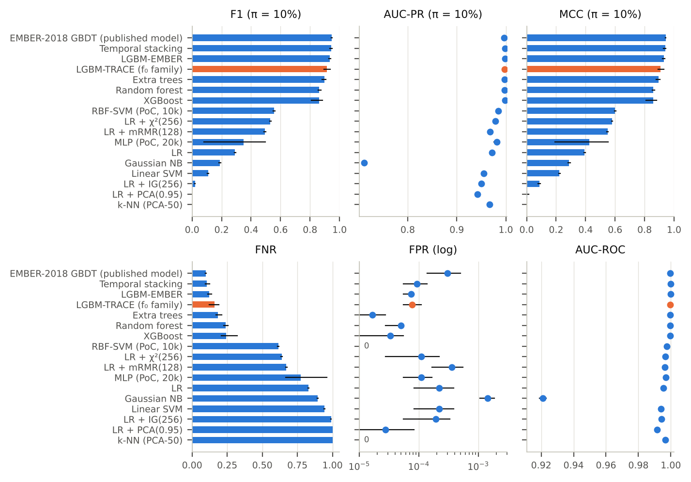
**Fig. 5.** Per-model detection metrics on the pooled March–September 2020 test stream (Dated stratum), threshold certified at τ_FPR = 0.1% on December 2019 (k* = 1). π-dependent metrics use the Eq. (70) re-weighting to π = 10%. Bars or dots: mean over model seeds (dots where the axis cannot start at zero: AUC-PR, AUC-ROC, log FPR; "0" = no false positive); whiskers: min–max over the seeds (multi-seed models) or the 95% stratified bootstrap CI (single fits; DeLong for AUC). Orange: LGBM-TRACE, the f₀ family. {MoC}

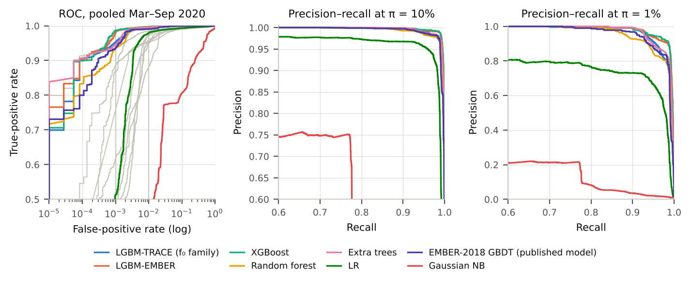
**Fig. 6.** Multi-model ROC (log FPR axis; grey: remaining models, incl. k-NN, LR variants, linear SVM) and precision–recall curves on the pooled March–September 2020 test stream. PR curves are computed with benign weights κ (Eq. 70) so that the effective prevalence is π = 10% (centre) and π = 1% (right). Vertical rules mark FPR = 0.1% and 1%. Seed 11 (stochastic) or the single fit (deterministic). {MoC}

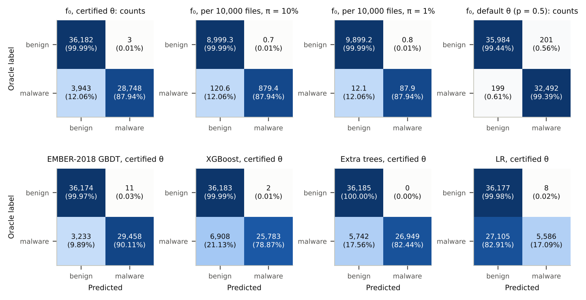
**Fig. 7.** Confusion matrices on the pooled March–September 2020 stream (36,185 benign, 32,691 malware). Top: the evidentiary detector f₀ (LGBM-TRACE, seed 11) at the CP-certified threshold (τ_FPR = 0.1%, k* = 1) as measured counts, as expected counts per 10,000 files at deployment prevalence π = 10% and 1% (analytic from the measured TPR and FPR), and at the default threshold p = 0.5. Bottom: comparators at their own certified thresholds (seed 11 or single fit). Cell shading = row-normalised rate. {MoC}

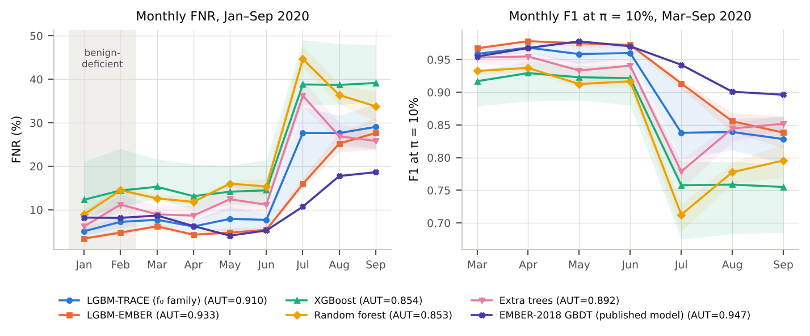
**Fig. 8.** Temporal decay under the TESSERACT protocol (train Aug–Nov 2019, calibrate Dec 2019, test monthly). Threshold certified at τ_FPR = 0.1% on December. Lines: seed mean; shaded band: min–max over the model seeds (multi-seed models). Left: FNR for every test month (Jan–Feb carry only 49 and 62 dated benign samples, so F1 is not reported there). Right: F1 at π = 10% (Eq. 70) with AUT (Eq. 69) over the seven months in the legend. {MoC}

**Tree ensembles dominate, and AUC hides why.** At the CP-certified 0.1% threshold, pooled March–September TPR is 89.44% for temporal stacking (Eq. 51; three seeds), 87.71% for LGBM-EMBER, 84.12% for LGBM-TRACE, a LightGBM [125] configuration (81.07–87.94% over five seeds), 81.60% for extra trees, 75.95% for random forest and 75.64% for XGBoost [66], all at realised FPR ≤ 0.011% {MoC}. Every linear model, Gaussian NB, kNN and the two proof-of-concept models (MLP, RBF-SVM) fall to 0.00–38.53% TPR at the same FPR budget, although all except NB reach AUC-ROC ≥ 99.16% {MoC}. The 48–84 pp TPR gap between LGBM-TRACE and the linear models lies entirely in the region FPR ≤ 0.1% of the ROC curve (Fig. 6), the only region an evidential operating point uses. AUC-ROC is therefore uninformative for model choice here; TPR at a certified FPR, F1 and precision at an assumed prevalence, and MCC are reported throughout. By AUT(F1 at π = 10%), the published EMBER-2018 GBDT (0.947), temporal stacking (0.941, range 0.929–0.948) and LGBM-EMBER (0.933, 0.924–0.939) lead; LGBM-TRACE follows at 0.910 (0.890–0.933) {MoC}. The proof-of-concept MLP is unstable across seeds (AUT 0.081–0.486), and the RBF-SVM made no false positive in seven months but recovers only 38.53% of malware {MoC}.

**The evidentiary detector.** f₀ (LGBM-TRACE, seed 11, fixed in the protocol before testing) reaches pooled TPR 87.94% [87.58, 88.28] at FPR 0.008% (3 of 36,185 benign; 95% CI [0.000, 0.019]), F1 at π = 10% 93.55% [93.34, 93.75], precision at π = 1% 99.08% [97.87, 100.00], MCC [155] 89.04% and AUC-ROC 99.971% [99.964, 99.977] {MoC}. f₀ is the best of the five LGBM-TRACE seeds on the test period: it has the lowest FNR of the five in every month and AUT 0.933 against 0.890–0.915 for the others {MoC}. It is not the strongest model in the zoo: temporal stacking makes fewer pooled errors (834 f₀-only against 75 stacking-only; McNemar p = 6.9 × 10⁻¹⁶³), and LGBM-EMBER is indistinguishable from it (516 against 477; p = 0.228) {MoC}. The evidentiary role was fixed before testing, and every tree ensemble shows the same July shift (Fig. 8), so the A2 conclusions do not depend on the choice. The pre-registration rules out selection, but single-model certificates must still be read against the seed spread: 6.87 pp in pooled TPR, and 16.81 pp in July FNR (16.76% for f₀ against 25.55–33.57% for the other seeds) {MoC}.

**Decay is an operating-point failure, not a ranking failure.** Monthly AUC-ROC of f₀ never drops below 99.929%, yet FNR at the December threshold rises from 4.98–6.51% (March–June) to 16.76% in July and 23.92–24.64% in August–September (Table 3, Fig. 8) {MoC}. FPR stays at 0–1 false positive per month. Averaged over the five seeds, monthly FNR rises from 6.16–7.91% in March–June to 27.62–29.05% in July–September (Fig. 8) {MoC}. New malware scores fall below a threshold fixed in December while still ranking above benign files, which is the failure a time-indexed certificate has to detect and expire on (Section 3.2). How large the failure is depends on the threshold: under [1]'s protocol with a much lower threshold, July–September FNR stays at 1.88–2.64% (Section 3.4) {MoC}. The published EMBER-2018 GBDT, trained on a different and older collection, attains the highest AUT(F1 at π = 10%) of all detectors, 0.947 against 0.910 for the LGBM-TRACE seed mean, with a higher realised FPR (0.030%, 11 of 36,185) {MoC}.

### 3.2 Time-indexed error certificates
**Table 4. Retrospective time-indexed error certificates (Eq. S7.4) and target-FPR violations by threshold rule**

| Month | θ@0.1%: FP/benign = FPR % (95% CP upper) | θ@0.1%: FNR % (upper) | θ@0.5%: FP/benign = FPR % (upper) | θ@0.5%: FNR % (upper) | θ@0.5% valid at (0.5%, 5%) |
|---|---|---|---|---|---|
| Dec 2019 (cal) | 1/6,120 = 0.016 (≤ 0.077) | 2.40 (≤ 2.84) | 21/6,120 = 0.343 (≤ 0.494) | 0.92 (≤ 1.20) | n/a |
| Jan 2020 | 0/49 = 0.000 (≤ 5.931) | 4.07 (≤ 4.59) | 0/49 = 0.000 (≤ 5.931) | 0.82 (≤ 1.08) | n/a |
| Feb 2020 | 0/62 = 0.000 (≤ 4.717) | 5.86 (≤ 6.50) | 3/62 = 4.839 (≤ 12.034) | 1.86 (≤ 2.25) | n/a |
| Mar 2020 | 1/3,577 = 0.028 (≤ 0.133) | 6.51 (≤ 7.12) | 3/3,577 = 0.084 (≤ 0.217) | 2.10 (≤ 2.47) | yes |
| Apr 2020 | 0/5,201 = 0.000 (≤ 0.058) | 4.98 (≤ 5.54) | 3/5,201 = 0.058 (≤ 0.149) | 1.75 (≤ 2.10) | yes |
| May 2020 | 1/6,121 = 0.016 (≤ 0.077) | 5.07 (≤ 5.58) | 3/6,121 = 0.049 (≤ 0.127) | 1.71 (≤ 2.02) | yes |
| Jun 2020 | 0/8,182 = 0.000 (≤ 0.037) | 5.62 (≤ 6.24) | 7/8,182 = 0.086 (≤ 0.161) | 2.56 (≤ 3.00) | yes |
| Jul 2020 | 0/6,392 = 0.000 (≤ 0.047) | 16.76 (≤ 17.65) | 6/6,392 = 0.094 (≤ 0.185) | 7.77 (≤ 8.42) | no |
| Aug 2020 | 0/2,514 = 0.000 (≤ 0.119) | 24.64 (≤ 25.81) | 1/2,514 = 0.040 (≤ 0.189) | 13.00 (≤ 13.93) | no |
| Sep 2020 | 1/4,198 = 0.024 (≤ 0.113) | 23.92 (≤ 24.98) | 5/4,198 = 0.119 (≤ 0.250) | 12.78 (≤ 13.62) | no |

| Threshold rule (fitted on December 2019) | Model×month cells (Mar–Sep) | Realised FPR > τ | CP lower bound > τ | Cells above τ by model |
|---|---|---|---|---|
| empirical 0.1% quantile of Dec benign ([1] protocol) | 273 | 14 (5.1%) | 6 | EMBER-2018 GBDT (published model) 6; RBF-SVM (PoC, 10k) 3; Gaussian NB 2; LR + χ²(256) 1; LR + PCA(0.95) 1; LR + IG(256) 1 |
| CP-certified, τ = 0.1% (k*) | 273 | 2 (0.7%) | 2 | Gaussian NB 2 |
| empirical 1% quantile | 273 | 44 (16.1%) | 25 | XGBoost 10; LGBM-TRACE (f₀ family) 8; EMBER-2018 GBDT (published model) 6; LGBM-EMBER 5; Random forest 5; Temporal stacking 3; LR + PCA(0.95) 2; Extra trees 1; Gaussian NB 1; MLP (PoC, 20k) 1; LR + mRMR(128) 1; Linear SVM 1 |
| CP-certified, τ = 1% | 273 | 21 (7.7%) | 15 | LGBM-TRACE (f₀ family) 5; EMBER-2018 GBDT (published model) 4; LGBM-EMBER 3; XGBoost 3; MLP (PoC, 20k) 1; LR + mRMR(128) 1; Gaussian NB 1; Random forest 1; Temporal stacking 1; Linear SVM 1 |

θ@0.1% = 6.348 (k* = 1), θ@0.5% = 2.899 (k* = 21), both certified on December 2019. A month is valid when both one-sided 95% Clopper–Pearson upper bounds are within tolerance. SVR (Mar–Sep): θ@0.1% with (0.1%, 2%): 0/7 (FPR-only 4/7 Mar–Sep; FNR-only 0/9 Jan–Sep); θ@0.5% with (0.5%, 5%): 4/7 (FPR-only 7/7 Mar–Sep; FNR-only 6/9 Jan–Sep). KS1 (≥ 6/7 at 0.5%) not met. January–February are not certifiable (49 and 62 dated benign). Second panel: all models and seeds; a cell violates the target when the month's realised FPR exceeds τ. {MoC}.

**Table 5. Censored benign strata, spike-day malware and the spike-rule sensitivity (f₀, θ@0.1%)**

| Month | Censored stratum | Dated benign | FPR dated (%) | Censored benign | FPR censored (%) (95% CP upper) | FPR pooled (%) | Shift (pp) | Bootstrap half-width (pp) |
|---|---|---|---|---|---|---|---|---|
| Jan 2020 | Placeholder | 49 | 0.00 | 5,870 | 0.187 (≤ 0.310) | 0.186 | 0.186 | 0.000 |
| Feb 2020 | Bulk | 62 | 0.00 | 3,641 | 0.330 (≤ 0.533) | 0.324 | 0.324 | 0.000 |

| Month | SpikeMal files | FNR spike-day malware (%) | FNR dated (%) | FNR pooled (%) |
|---|---|---|---|---|
| Jan 2020 | 110 | 0.91 | 4.07 | 3.99 |
| Feb 2020 | 239 | 19.25 | 5.86 | 6.61 |

| June 2020 rule | Files | FNR (%) | FPR (%) | F1 native (%) |
|---|---|---|---|---|
| spike rule k = 10 (primary) | 12,399 | 5.62 | 0.000 | 97.11 |
| spike rule k = 4 (sensitivity) | 10,985 | 5.86 | 0.000 | 96.98 |

Placeholder (January) and Bulk (February) benign files carry batch timestamps and are excluded from the Dated stream (S7). The KB5 rule (shift > bootstrap half-width) is met literally in both months, but the half-width is zero because the dated stratum has 0/49 and 0/62 false positives; the test is degenerate and reported as inconclusive. Both censored strata alone fail the 0.1% FPR certificate (CP upper 0.31% and 0.53%). {MoC}.

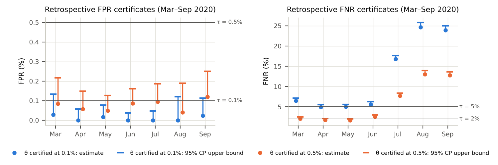
**Fig. 9.** Time-indexed error certificates of f₀ (Eq. S7.4): monthly point estimates and one-sided 95% Clopper–Pearson upper bounds for FPR (left) and FNR (right), with the threshold certified on December 2019 at τ_FPR = 0.1% (k* = 1) and 0.5% (k* = 21). Horizontal rules: tolerances τ. {MoC}

**Certificates hold until the July shift, then expire.** With θ certified on December 2019 at τ_FPR = 0.5% (k* = 21), the joint certificate (FPR ≤ 0.5%, FNR ≤ 5%, both by one-sided 95% Clopper–Pearson bounds [133]) is valid in March–June and fails in July–September, when the FNR upper bound reaches 8.42–13.93% {MoC}. SVR is 4/7, so KS1 (≥ 6/7) is not met. The FPR half of the certificate holds in all seven months (upper bounds 0.127–0.250%) {MoC}. At τ_FPR = 0.1% (k* = 1) the FPR certificate holds in four months (April–July). It fails in March and September, each with one false positive, and in August with none: 0 of 2,514 benign files gives an upper bound of 0.119%, so August is uncertifiable for lack of data, not because of the model {MoC}. No month certifies FNR ≤ 2% at that threshold.

**Uncertified thresholds overrun their budget.** Across all detectors and seeds (273 model-months), the empirical 0.1% quantile of December benign scores ([1]'s protocol) produced a realised monthly FPR above 0.1% in 14 cells (5.1%), 6 of them with the Clopper–Pearson lower bound also above 0.1% {MoC}. Six of the fourteen belong to the published EMBER-2018 GBDT, whose pooled FPR at that threshold is 0.193% (70 of 36,185), and three to the RBF-SVM. The CP-certified threshold reduced the count to 2 cells (0.7%), both Gaussian NB {MoC}. At τ = 1% the counts are 44 (16.1%) and 21 (7.7%) {MoC}.

**Static evaluation overstates evidential quality (KB4).** A random 80:20 split of the same training window reports FNR 1.58% and FPR 0.018%. The temporal certificates show monthly FNR 3.4–23.1 pp higher in all seven months {MoC}. An error rate stated from a static split would have been wrong in every month of deployment.

**Censored strata.** The batch-dated benign files that S7 removed from the Dated stream are harder than the dated benign files of the same months: Placeholder FPR 0.187% (11/5,870; CP upper 0.310%) and Bulk FPR 0.330% (12/3,641; upper 0.533%), against 0/49 and 0/62 for dated benign in January and February {MoC}. Either stratum alone fails a 0.1% certificate. KB5 is met literally, but the bootstrap half-width it compares against is zero because the dated strata have no false positives. The test is degenerate and is reported as inconclusive, with the exact intervals above. Spike-day malware (R-S1) shows FNR 0.91% (1/110) in January and 19.25% (46/239) in February {MoC}. The k = 4 spike rule moves June FNR from 5.62% to 5.86% {MoC}.

### 3.3 Base rate, calibration and cost-sensitive thresholds
**Table 6. Precision (%) under deployment prevalence π: measured streams versus Eq. (55)**

| Month | π = 1% | π = 2% | π = 5% | π = 10% | Default θ: Prec @π=0.1% | Default θ: Prec @π=1% |
|---|---|---|---|---|---|---|
| Mar 2020 | 97.07 [96.82, 97.30] / 97.12 | 98.55 [98.48, 98.62] / 98.56 | 99.43 [99.41, 99.44] / 99.44 | 99.73 [99.72, 99.74] / 99.73 | 8.53 | 48.49 |
| Apr 2020 | 100.00 [100.00, 100.00] / 100.00 | 100.00 [100.00, 100.00] / 100.00 | 100.00 [100.00, 100.00] / 100.00 | 100.00 [100.00, 100.00] / 100.00 | 5.45 | 36.77 |
| May 2020 | 98.31 [98.19, 98.39] / 98.32 | 99.17 [99.14, 99.19] / 99.16 | 99.67 [99.67, 99.68] / 99.67 | 99.85 [99.84, 99.85] / 99.85 | 33.69 | 83.68 |
| Jun 2020 | 100.00 [100.00, 100.00] / 100.00 | 100.00 [100.00, 100.00] / 100.00 | 100.00 [100.00, 100.00] / 100.00 | 100.00 [100.00, 100.00] / 100.00 | 27.05 | 78.91 |
| Jul 2020 | 100.00 [100.00, 100.00] / 100.00 | 100.00 [100.00, 100.00] / 100.00 | 100.00 [100.00, 100.00] / 100.00 | 100.00 [100.00, 100.00] / 100.00 | 29.76 | 81.05 |
| Aug 2020 | 100.00 [100.00, 100.00] / 100.00 | 100.00 [100.00, 100.00] / 100.00 | 100.00 [100.00, 100.00] / 100.00 | 100.00 [100.00, 100.00] / 100.00 | 23.84 | 75.96 |
| Sep 2020 | 96.91 [96.43, 97.30] / 96.99 | 98.50 [98.37, 98.63] / 98.49 | 99.41 [99.38, 99.44] / 99.41 | 99.72 [99.71, 99.73] / 99.72 | 20.67 | 72.44 |

Certified θ@0.1% columns: mean [2.5, 97.5 percentile] over 20 prevalence-resampled streams / analytic value from the month's measured TPR and FPR. Analytic value outside the measured interval in 0% of the 28 cells (P2 not falsified). No month had realised FPR ≥ 0.1% at the certified threshold, so the second clause of P2 is untestable. Default θ (p = 0.5): analytic precision from the month's measured rates. {MoC}.

**Table 7. Calibration under drift, prior shift and cost-sensitive thresholds (P4, P7, H6, H10)**

| Month | ECE raw sigmoid (%) | ECE isotonic (%) | ECE Platt (%) | Brier ×10³ @π=1%: iso / prior-shift | Brier ×10³ @π=0.1%: iso / prior-shift | EC ×10³ @π=1%, C_FN/C_FP = 100: τ* / 0.5 |
|---|---|---|---|---|---|---|
| Mar 2020 | 0.63 | 1.38 | 1.05 | 2.38 / 0.81 | 2.25 / 0.13 | 19.2 / 26.7 |
| Apr 2020 | 0.68 | 0.80 | 0.59 | 2.61 / 0.49 | 2.54 / 0.10 | 10.7 / 23.2 |
| May 2020 | 0.18 | 0.96 | 0.75 | 0.72 / 0.61 | 0.61 / 0.12 | 12.3 / 25.9 |
| Jun 2020 | 0.17 | 0.70 | 0.54 | 1.05 / 0.56 | 0.94 / 0.11 | 11.8 / 33.0 |
| Jul 2020 | 0.54 | 3.10 | 2.15 | 1.10 / 1.64 | 0.75 / 0.30 | 28.5 / 96.0 |
| Aug 2020 | 1.41 | 6.80 | 4.95 | 1.32 / 2.36 | 0.77 / 0.32 | 53.0 / 155.5 |
| Sep 2020 | 1.18 | 5.66 | 4.21 | 1.74 / 2.52 | 1.20 / 0.56 | 59.4 / 153.4 |

| π | C_FN/C_FP | mean EC(τ*) ×10³ | mean EC(0.5) ×10³ | months τ* lower | Wilcoxon p |
|---|---|---|---|---|---|
| 1% | 10 | 11.19 | 7.76 | 0/7 | 0.016 |
| 1% | 50 | 37.11 | 36.92 | 1/7 | 0.062 |
| 1% | 100 | 27.86 | 73.38 | 7/7 | 0.016 |
| 0.1% | 10 | 1.35 | 1.20 | 3/7 | 0.297 |
| 0.1% | 50 | 5.65 | 4.12 | 0/7 | 0.016 |
| 0.1% | 100 | 11.19 | 7.76 | 0/7 | 0.016 |

Calibrators fitted on December 2019 (π_cal = 39.8%). Isotonic ECE exceeded raw ECE in every month (isotonic raised ECE by 2.09 pp on average, 95% CI [0.71, 3.50]; Wilcoxon p = 0.016), so P4's calibrator clause is falsified. Prior shift (Eq. 31) lowered Brier at π = 0.1% (p = 0.016) but not at π = 1% (p = 0.812). P7 survives on one of six (π, ratio) cells. H6 (F1 at π* = 10% with the π*-aware threshold vs 0.5): mean −3.29 pp (p = 0.297), not supported. H10: Spearman ρ(month, isotonic ECE) = 0.47 (p = 0.21); met by the pre-registered sign rule, not significant. {MoC}.

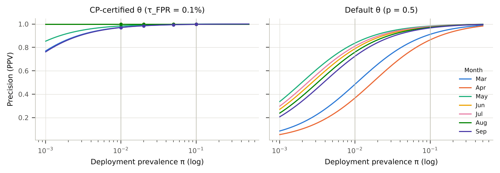
**Fig. 10.** Base-rate sensitivity of f₀: precision versus deployment prevalence π. Curves: Eq. (55) evaluated with each month's measured TPR and FPR; points (left): mean and 2.5–97.5 percentiles over 20 prevalence-resampled streams at π ∈ {1, 2, 5, 10}%. The certified threshold keeps PPV high at low π because realised FPR is 0–3 per 10⁴ benign files; the default threshold collapses PPV in March–April. {MoC}

**The base-rate fallacy [59] is the operating-point problem seen from the reader's side.** At an assumed deployment prevalence π = 1%, the certified threshold keeps monthly precision between 96.91% and 100% {MoC}. The default threshold (p = 0.5), whose native-ratio F1 is a flattering 99.39%, falls to 36.77% in April and 48.49% in March, and to 5.45–33.69% at π = 0.1% (Table 6, Fig. 10) {MoC}. Pooled over March–September, precision at π = 1% is 99.08% for the certified threshold against 64.38% for the default; at π = 0.1% it is 91.39% against 15.19% {MoC}. Eq. (55) evaluated with the month's measured TPR and FPR fell inside the 2.5–97.5 percentile band of 20 prevalence-resampled streams in all 28 month × π cells, so P2 is not falsified and the analytic correction (70) can stand in for resampling {MoC}. The second clause of P2 (precision at π = 0.1% below 0.6 when realised FPR ≥ 0.1%) is untestable here: no month reached that FPR at the certified threshold.

**Recalibration on December does not survive drift (P4 falsified).** Isotonic regression [152] and Platt scaling [151] fitted on December 2019 increased ECE [157] in every test month. The isotonic increase averages 2.09 pp (95% CI 0.71–3.50; Wilcoxon p = 0.016) and reaches 6.80% in August, against 1.41% for the raw sigmoid of the margin {MoC}. Prior-shift correction (Eq. 31 [153]) lowers the Brier score [156] at π = 0.1% (p = 0.016) but not at π = 1% (p = 0.812) {MoC}. The Bayes-cost threshold τ* (Eqs. 53–54 [154]) beats 0.5 on expected cost in one of six (π, cost-ratio) cells: π = 1% with C_FN/C_FP = 100, mean EC 27.86 against 73.38 (×10⁻³), lower in 7/7 months. It loses at ratio 10 (11.19 against 7.76), so P7 survives only by its permissive rule {MoC}. In the S9 form of the hypothesis (H6), the π*-aware threshold lowers F1 at π* = 10% by 3.29 pp on average (p = 0.297) {MoC}. ECE rises with month (ρ = 0.47, p = 0.21; H10 met by its sign rule only). Calibrated probabilities are therefore not reported as evidential quantities. The evidential statement stays the certified error bound plus a prevalence-conditional precision bound.

**Likelihood-ratio reporting remains viable.** The log-likelihood-ratio cost Cllr [106] of score-based likelihood ratios calibrated on December is 0.016 in December and 0.026–0.107 in March–September, never ≥ 1, so KB12 is not triggered {MoC}. Cllr rises fourfold between June (0.026) and August (0.107), in step with the July shift. Any LR statement therefore needs the same expiry discipline as the error certificates.

### 3.4 Experimental-bias controls
**Table 8. Experimental-bias controls: random versus temporal split (P1), static 80:20 versus temporal certificates (KB4), timestamp artefact (H9), pre-window benign, leakage (P3) and monotone-scaling invariance (P9)**

| Arm | Random-split F1 @π=10% (%) | Temporal AUT(F1@π=10%) (%) | Inflation (pp) | Random-split FNR (%) | Random-split FPR (%) |
|---|---|---|---|---|---|
| seed 11 | 96.04 | 93.35 | +2.69 | 7.55 | 0.008 |
| seed 23 | 98.76 | 89.52 | +9.24 | 1.66 | 0.090 |
| seed 37 | 98.81 | 91.36 | +7.45 | 1.97 | 0.043 |
| seed 41 | 97.99 | 89.03 | +8.97 | 3.73 | 0.024 |
| seed 53 | 97.80 | 91.51 | +6.29 | 4.16 | 0.016 |
| mean [95% CI] |  |  | +6.93 [4.59, 8.72] |  |  |

| Month | Static 80:20 FNR (%) | Temporal FNR (%) | Static FPR (%) | Temporal FPR (%) | Static understates |
|---|---|---|---|---|---|
| Mar 2020 | 1.58 | 6.51 | 0.018 | 0.028 | yes |
| Apr 2020 | 1.58 | 4.98 | 0.018 | 0.000 | yes |
| May 2020 | 1.58 | 5.07 | 0.018 | 0.016 | yes |
| Jun 2020 | 1.58 | 5.62 | 0.018 | 0.000 | yes |
| Jul 2020 | 1.58 | 16.76 | 0.018 | 0.000 | yes |
| Aug 2020 | 1.58 | 24.64 | 0.018 | 0.000 | yes |
| Sep 2020 | 1.58 | 23.92 | 0.018 | 0.024 | yes |

| Variant | Effect | Δ | Outcome |
|---|---|---|---|
| Without COFF timestamp (feature 626), H9 | AUT(F1@π=10%) 93.35 → 92.93 | −0.42 pp | met (absolute Δ < 1 pp) |
| +13,834 PreWindow benign in training | pooled FNR 12.06% → 8.40%; FPR 2/36,185 | −3.66 pp FNR | descriptive (S7 excluded PreWindow from the primary split) |

| Model | CV folds | Random 5-fold CV: F1 @π=10% (%) mean (min–max) | Temporal months Mar–Sep: F1 @π=10% (%) mean (min–max) | Δ CV − temporal (pp) | CV FNR (%) | Temporal FNR (%) | CV FPR (%) |
|---|---|---|---|---|---|---|---|
| LGBM-TRACE (f₀ family) | 5 | 99.30 (99.23–99.46) | 90.72 (82.83–96.82) | +8.58 | 1.10 | 16.25 | 0.032 |
| XGBoost | 5 | 99.39 (99.29–99.49) | 85.17 (75.51–92.93) | +14.22 | 0.79 | 24.81 | 0.046 |
| Extra trees (100 trees in CV) | 5 | 99.20 (99.04–99.33) | 89.38 (77.86–95.47) | +9.82 | 1.17 | 18.59 | 0.046 |
| Random forest (100 trees in CV) | 5 | 99.06 (98.91–99.26) | 85.50 (71.26–93.72) | +13.56 | 1.39 | 24.37 | 0.054 |
| LR | 5 | 25.39 (0.35–60.45) | 27.66 (16.18–48.28) | −2.27 | 83.48 | 83.47 | 0.019 |
| Gaussian NB | 5 | 22.74 (0.02–41.54) | 18.90 (4.76–31.16) | +3.84 | 85.86 | 89.13 | 0.035 |

| T0 replication of [1] Table III (train < 2019-10-01, 80:20 random split, empirical 0.1% validation threshold; test Oct 2019–Sep 2020) | Training / threshold | FNR Jul–Sep 2020 (%) | Monthly FNR (%) | Monthly FPR (%) | Months FPR > 0.1% | Unseen-family FNR (%) | Seen-family FNR (%) |
|---|---|---|---|---|---|---|---|
| [1] Table III {RfP} | BODMAS before 2019-10-01 | — | 1.71–7.23 | 0.00–0.51 | — | ≤ 43.04 | within 6 |
| Dated only, LGBM-EMBER {MoC} | 6,778 train / 1,694 val; θ = 8.946 (k = 0) | 13.25–20.45 | 1.91–20.45 | 0.000–0.108 | 1/12 | ≤ 42.17 | ≤ 20.92 |
| Dated only, LGBM-TRACE params {MoC} | 6,778 train / 1,694 val; θ = 5.849 (k = 0) | 15.36–22.84 | 2.92–22.84 | 0.000–0.065 | 0/12 | ≤ 54.22 | ≤ 23.41 |
| Dated + PreWindow, LGBM-EMBER {MoC} | 17,845 train / 4,461 val; θ = −0.115 (k = 3) | 1.88–2.64 | 1.19–3.43 | 0.000–0.119 | 3/12 | ≤ 29.09 | ≤ 2.93 |
| Dated + PreWindow, LGBM-TRACE params {MoC} | 17,845 train / 4,461 val; θ = −0.791 (k = 3) | 2.09–2.82 | 0.87–3.45 | 0.000–1.019 | 7/12 | ≤ 26.67 | ≤ 3.03 |

| Model | Pre-split fit | AUC-ROC (%) clean → leaky | AUC-PR @π=10% (%) clean → leaky | FNR @θ0.1% (%) clean → leaky | ΔAUC (pp) | DeLong p |
|---|---|---|---|---|---|---|
| LR | z-score scaler | 99.529 → 99.628 | 97.15 → 97.40 | 82.92 → 86.28 | +0.100 | 6.3e-10 |
| LR | χ² selector (256) | 99.668 → 99.808 | 97.84 → 98.39 | 66.44 → 57.71 | +0.140 | 1.6e-16 |
| LR | PCA (0.95) | 99.158 → 99.018 | 94.23 → 90.64 | 99.99 → 99.85 | −0.139 | 1.6e-04 |
| Linear SVM | z-score scaler | 99.389 → 99.357 | 95.49 → 95.16 | 94.27 → 94.48 | −0.032 | 0.004 |
| Linear SVM | χ² selector (256) | 99.683 → 99.811 | 97.92 → 98.30 | 77.42 → 63.80 | +0.128 | 1.4e-14 |
| Linear SVM | PCA (0.95) | 98.988 → 98.528 | 93.22 → 86.68 | 99.38 → 99.93 | −0.461 | 1.1e-25 |

LightGBM under clean versus leaky z-scaling: margins differ (maximum absolute difference 2.02); decision agreement 99.903%.

| Model | Comparison | Disagreements | Agreement (%) |
|---|---|---|---|
| Decision tree | raw vs min-max | 489/77,417 | 99.368 |
| Decision tree | raw vs z-score | 305/77,417 | 99.606 |
| Random forest (100 trees) | raw vs min-max | 183/77,417 | 99.764 |
| Random forest (100 trees) | raw vs z-score | 131/77,417 | 99.831 |
| LightGBM | raw vs min-max | 75/77,417 | 99.903 |
| LightGBM | raw vs z-score | 82/77,417 | 99.894 |
| LR | raw vs z-score | 3,231/20,000 | 83.845 |
| k-NN | raw vs z-score | 2,315/20,000 | 88.425 |

Random arm: same model and training size, rows drawn uniformly from the pooled Dated stream, certified threshold on a random calibration hold-out (biased by construction). Relative inflation of the mean: +7.66%. Leakage arms fit the scaler, χ² selector (labels included) or PCA on all Dated rows (train + calibration + test) before training. {MoC}.

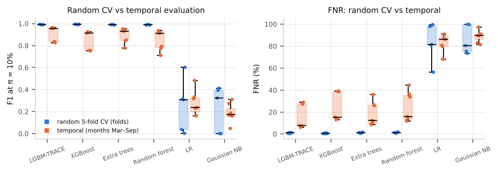
**Fig. 16.** Distribution of F1 at π = 10% and FNR under random stratified 5-fold cross-validation of the pooled Dated stream (biased arm; certified threshold on a 10% calibration hold-out per fold) versus the temporal protocol (monthly values, March–September 2020; seed mean). Box: inter-quartile range; points: folds or months. ET and RF use 100 trees in the CV arm. {MoC}

**Random splitting inflates detection quality (P1 not falsified).** Arp et al. [12] list sampling bias and data snooping among the most common pitfalls in security ML. With the same model, training size and certification rule, rows drawn uniformly from the pooled Dated stream raise F1 at π = 10% by +6.93 pp (95% CI 4.59–8.72; +7.66% relative) over the temporal AUT. The inflation ranges from +2.69 to +9.24 pp across seeds {MoC}. Random stratified 5-fold cross-validation over the pooled Dated stream, which mixes all months into training, inflates further. Tree ensembles reach F1 at π = 10% of 99.06–99.39% with FNR 0.79–1.39% at a certified 0.1% threshold, against temporal monthly means of 85.17–90.72% and 16.25–24.81% FNR: an inflation of +8.58 to +14.22 pp in F1 and an FNR understated by 15.2–24.0 pp (Table 8, Fig. 16) {MoC}. Linear models fail at the certified operating point under both protocols (CV F1 22.74–25.39%), so CV does not inflate them. EMBER-2018 shows the same bias at nearly three times the size (+19.86 pp, Section 3.9).

**The timestamp artefact is negligible (H9 met).** Removing the COFF TimeDateStamp (feature 626) changes AUT(F1 at π = 10%) by −0.42 pp and AUT(TPR) by −0.73 pp {MoC}. S7 showed that this feature alone separates benign halves at AUC 0.695 {MoC, S7}, so the monitor excludes it. The detector does not depend on it.

**Pre-window benign files help recall.** Adding the 13,834 benign files first seen before 2019-08-29 to training only, which is TESSERACT-legal [11], lowers pooled FNR from 12.06% to 8.40% at a realised FPR of 2/36,185 {MoC}. S6 kept these files out of the primary analysis to avoid the benign-age confound in drift statistics. The 3.66 pp recall gain is reported as a sensitivity result and an option for deployment, not as the headline.

**Leakage through pre-split feature selection is real (P3 not falsified).** Fitting the χ² selector on all Dated rows, test labels included, raises the AUC-ROC of LR by 0.140 pp (DeLong [144] p = 1.6 × 10⁻¹⁶) and of linear SVM by 0.128 pp (p = 1.4 × 10⁻¹⁴) {MoC}. The effect is far larger at the certified operating point. FNR falls from 66.44% to 57.71% (LR) and from 77.42% to 63.80% (SVM), and F1 at π = 10% rises by 9.18 and 16.29 pp {MoC}. The leaky and clean selections share 215 of 256 features {MoC}. Pre-split scaling has small, mixed effects (+0.100 pp AUC for LR, −0.032 pp for SVM). Pre-split PCA lowers AUC (−0.139 and −0.461 pp), and the leaky fit keeps 1,328 components instead of 1,151 {MoC}, so the PCA clause of P3 is not supported. A leak that is nearly invisible in AUC moves the evidential operating point by 9–16 pp, so leakage controls must be judged at the threshold actually used.

**Monotone rescaling does not leave tree implementations exactly invariant (P9 falsified as stated).** Exact trees are invariant to per-feature strictly increasing maps in exact arithmetic (Eq. 11). In float32 implementations they are not. A depth-14 decision tree changes 489 (min-max) and 305 (z-score) of 77,417 test verdicts; a 100-tree random forest changes 183 and 131; LightGBM changes 75 and 82, i.e. 99.89–99.90% agreement, short of the 99.99% the prediction set for histogram GBDT {MoC}. Scale-sensitive models move an order of magnitude more: LR changes 3,231 and kNN 2,315 of 20,000 verdicts (83.8% and 88.4% agreement) {MoC}. The likely cause is float32 resolution after rescaling features with very large ranges (sizes, timestamps). scikit-learn trees cast inputs to float32, so distinct raw values can merge, and LightGBM's binning treats exact zeros specially, so an affine shift can change bin boundaries. The ordering P9 predicted holds; exact invariance does not. For evidence handling, the preprocessing transform is part of the model identity and must be hashed with it, as the ledger already does.

**Replicating BODMAS Table III (T0) shows what drives the July collapse.** BODMAS [1] trained on every file first seen before 1 October 2019, used an 80:20 random split and set the threshold at the empirical 0.1% FPR of the validation benign files. Repeating that protocol on our strata with the pre-window benign files included, as [1] did, LGBM-EMBER reproduces [1]'s magnitudes. Monthly FNR is 1.19–3.43% against 1.71–7.23% {RfP}; FPR is 0.000–0.119% against 0.00–0.51%; unseen-family FNR reaches at most 29.09% against 43.04% {MoC vs RfP}. July–September FNR stays at 1.88–2.64% {MoC}. Without the pre-window benign files the same protocol gives 13.25–20.45% in July–September {MoC}, the collapse seen under the S7 protocol. Two mechanisms are confounded here. Benign training diversity lowers the scores of dated benign files, and the threshold sits far lower: margin −0.115 with three validation false positives allowed, against 8.946 when fewer than 1,000 validation benign files force the threshold above every one of them {MoC}. The uncertified empirical threshold does not hold its FPR budget either. With LGBM-TRACE parameters, realised FPR exceeds 0.1% in 7 of 12 months and reaches 1.019% in April 2020; LGBM-EMBER exceeds it in 3 of 12 {MoC}. The certified threshold sits at the other extreme. Its realised monthly FPR of 0.000–0.028% is at least 3.5 times below the 0.1% target {MoC}, the recall price of certifying with one allowed false positive among 6,120 December benign files.

### 3.5 Error structure, drift and the label-free monitor
**Table 9. Error structure of f₀ at θ@0.1%: entropy strata (P10), unseen versus known families (H3) and the families behind the July–September decay**

| High-entropy definition | Error | High stratum: errors/n = % | Low stratum: errors/n = % | Odds ratio [95% CI] | Fisher p |
|---|---|---|---|---|---|
| Eq. (19) packing indicator, τ_p = 1/32 | FNR | 3,040/23,587 = 12.888 | 903/9,104 = 9.919 | 1.34 [1.24, 1.45] | 5.9e-14 |
| Eq. (19) packing indicator, τ_p = 1/32 | FPR | 2/24,561 = 0.008 | 1/11,624 = 0.009 | 0.95 [0.09, 10.44] | 1.000 |
| byte mass in the two highest entropy bins > 0.5 | FNR | 2,675/18,839 = 14.199 | 1,268/13,852 = 9.154 | 1.64 [1.53, 1.76] | 1.3e-44 |
| byte mass in the two highest entropy bins > 0.5 | FPR | 2/18,117 = 0.011 | 1/18,068 = 0.006 | 1.99 [0.18, 22.00] | 1.000 |

| Month | Unseen-family malware | FNR unseen (%) | Known-family malware | FNR known (%) |
|---|---|---|---|---|
| Jan 2020 | 63 | 36.51 | 4,337 | 3.60 |
| Feb 2020 | 78 | 37.18 | 3,952 | 5.24 |
| Mar 2020 | 71 | 45.07 | 4,919 | 5.96 |
| Apr 2020 | 71 | 15.49 | 4,569 | 4.82 |
| May 2020 | 161 | 28.57 | 5,288 | 4.35 |
| Jun 2020 | 69 | 26.09 | 4,148 | 5.28 |
| Jul 2020 | 734 | 8.72 | 4,261 | 18.14 |
| Aug 2020 | 131 | 32.06 | 3,692 | 24.38 |
| Sep 2020 | 246 | 59.76 | 4,331 | 21.89 |

| Family (Jul–Sep 2020) | Seen in training | Malware files | False negatives | FNR (%) | Share of all Jul–Sep FN (%) |
|---|---|---|---|---|---|
| wabot | yes | 1,958 | 1,269 | 64.8 | 44.2 |
| ceeinject | yes | 814 | 272 | 33.4 | 9.5 |
| zbot | yes | 280 | 210 | 75.0 | 7.3 |
| tofsee | yes | 304 | 157 | 51.6 | 5.5 |
| salgorea | yes | 197 | 131 | 66.5 | 4.6 |
| wacatac | yes | 267 | 105 | 39.3 | 3.7 |
| glupteba | yes | 100 | 100 | 100.0 | 3.5 |
| cosmicduke | no | 57 | 57 | 100.0 | 2.0 |
| all families |  | 13,395 | 2,874 | 21.5 | 100.0 |

P10 is falsified for FPR (3 false positives in total; the odds-ratio CI spans 1) and holds for FNR. H3: Wilcoxon over months p = 0.0117, A12 = 0.926 (met), yet July–September FNR is driven by families present in training. Family labels are BODMAS family tokens (RecMaL [92] estimates about 20% of them shifted or wrong). {MoC}.

**Table 10. Feature drift (Eqs. 74–75) and the label-free monitor M8 (KT)**

| Month | 𝒟(t) ×10³ (bits) | benign-class 𝒟 ×10³ | malware-class 𝒟 ×10³ | FNR f₀ at θ@0.1% (%) |
|---|---|---|---|---|
| Dec 2019 | 3.03 | 2.74 | 7.72 | 2.40 |
| Jan 2020 | 15.76 | 35.53 | 5.45 | 4.07 |
| Feb 2020 | 19.26 | 52.04 | 10.65 | 5.86 |
| Mar 2020 | 5.34 | 2.05 | 11.99 | 6.51 |
| Apr 2020 | 4.11 | 4.98 | 8.45 | 4.98 |
| May 2020 | 8.00 | 6.58 | 17.24 | 5.07 |
| Jun 2020 | 11.44 | 6.03 | 32.84 | 5.62 |
| Jul 2020 | 8.65 | 4.03 | 24.40 | 16.76 |
| Aug 2020 | 10.12 | 4.92 | 28.84 | 24.64 |
| Sep 2020 | 4.79 | 4.82 | 20.13 | 23.92 |

| Statistic | Class | λ (max over blocked null) | Test windows above λ |
|---|---|---|---|
| C2ST AUC (T5) | pred. benign | 0.779 | 22/31 |
| C2ST AUC (T5) | pred. malicious | 0.882 | 28/31 |
| KS on margins (T1) | pred. benign | 0.221 | 5/31 |
| KS on margins (T1) | pred. malicious | 0.192 | 24/31 |
| mean PSI (T2) | pred. benign | 0.068 | 5/31 |
| mean PSI (T2) | pred. malicious | 0.169 | 9/31 |
| 1 − mean credibility (T3) | pred. benign | 0.602 | 2/31 |
| 1 − mean credibility (T3) | pred. malicious | 0.557 | 21/31 |

| Signal | Alarms Mar–Sep | First alarm | First alarm after 5 Jul onset |
|---|---|---|---|
| M8 rule (P = 2 consecutive exceedances, re-arm) | 1 | 2020-03-15 | — (none) |
| ACI, label delay 7 d | 115 | 2020-03-09 | 2020-07-07 |
| ACI, label delay 30 d | 92 | 2020-04-01 | 2020-07-05 |

January–February benign-class values rest on 49 and 62 dated benign files and are inflated by small-sample JS bias. P5: Spearman ρ(𝒟, F1@π=10%) = −0.32 (p = 0.49), falsified. Exploratory (not pre-registered): ρ(malware-class 𝒟, FNR), Mar–Sep = 0.54 (permutation p = 0.241, n = 7). Monitor: 31 weekly test windows; every window exceeds at least one λ; one alarm (2020-03-15), no alarm within 14 d of the July onset week (2020-07-05); false alarms in stable months: Mar 2020 1, Apr 2020 0, May 2020 0, Jun 2020 0. KT met → trigger claim withdrawn. {MoC}.

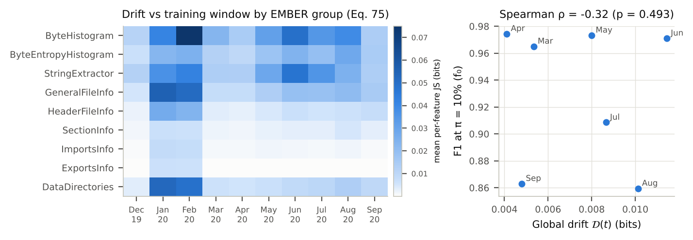
**Fig. 11.** Feature drift relative to the training window (Aug–Nov 2019): per-group Jensen–Shannon divergence on 20 training-quantile bins (Eqs. 74–75) for December 2019 and each 2020 month (left; January–February values are inflated by the 49 and 62 dated benign files), and global drift 𝒟(t) against f₀'s monthly F1 at π = 10% over March–September (right; P5). {MoC}

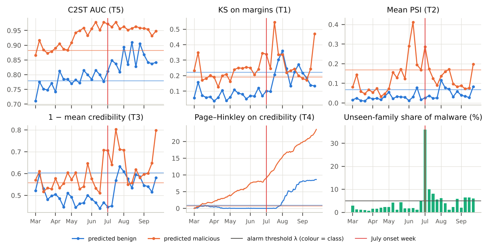
**Fig. 12.** Label-free monitor M8 on weekly windows from 1 March 2020 (f₀, predicted-class conditioning, COFF column excluded). Thin horizontal lines: alarm thresholds λ = maximum over the blocked null (86 Oct–Dec windows for C2ST/PSI; 25 December windows for KS/credibility; December daily series for Page–Hinkley). Red rule: July onset week (unseen-family share > 5%). Every test window exceeds at least one λ, so the monitor cannot separate the July event from ordinary non-stationarity (trigger kill KT met). {MoC}

**Packed-looking files are missed more often (P10 holds for FNR only).** Malware flagged by the Eq. (19) packing indicator has 12.89% FNR against 9.92% for the rest (odds ratio 1.34 [1.24, 1.45]; Fisher p = 5.9 × 10⁻¹⁴). With a mass-based definition the odds ratio is 1.64 [1.53, 1.76] {MoC}. The FPR half of P10 cannot be tested: f₀ made 3 false positives in seven months (OR 0.95 [0.09, 10.44]). This agrees in direction with the packing results of Aghakhani et al. [35]. It does not settle the contradiction with Dambra et al. [8] noted in S2, because packing is approximated from byte-entropy features rather than observed.

**Unseen families are missed more often, but they do not drive the decay.** FNR on families absent from training exceeds FNR on known families in 8 of 9 months (Wilcoxon p = 0.0117, Vargha–Delaney A12 [143] = 0.926; H3 met) {MoC}. The July–September collapse is nevertheless a known-family event. Of 2,874 false negatives in those months, 2,244 (78.1%) come from seven families present in training, led by wabot with 1,269 misses (64.8% of its 1,958 files; 44.2% of all misses). In July the unseen-family FNR (8.72%) is half the known-family FNR (18.14%) {MoC}. BODMAS reported the same asymmetry for its Table III model: within 6% FNR for seen families against up to 43.04% for unseen families [1] {RfP}. Under our protocol the seen-family figure reaches 24.38% (August) {MoC}, so a "seen family" label is no guarantee of detection once a family's variants drift.

**Feature drift does not predict decay (P5 falsified).** Pooled JS drift 𝒟(t) (Eqs. 74–75 [150]) is largest in January–February (15.76 and 19.26 ×10⁻³ bits). That is the small-sample benign class (49 and 62 files), and FNR there is still 4.07–5.86% {MoC}. Over March–September, ρ(𝒟, F1 at π = 10%) = −0.32 (p = 0.49; 95% CI upper bound 0.76) {MoC}. Restricting 𝒟 to the malware class gives an exploratory ρ(𝒟_mal, FNR) = 0.54 (permutation p = 0.24, n = 7, not pre-registered) {MoC}. Malware-class drift peaks in June (32.84 ×10⁻³), one month before the FNR jump. Seven months cannot resolve whether that lead is real. Group-wise, ByteHistogram and StringExtractor carry most of the March–September drift, followed by ByteEntropyHistogram and GeneralFileInfo (Fig. 11).

**The label-free monitor cannot separate the July event from ordinary non-stationarity (KT met).** Against blocked nulls of 86 October–December windows (C2ST [126], PSI) and 25 December windows (KS on margins, credibility), every one of the 31 weekly test windows exceeds at least one threshold λ (Fig. 12) {MoC}. C2ST on predicted-malicious files exceeds λ in 28/31 windows and KS on their margins in 24/31. Page–Hinkley [149] on predicted-malicious credibility crosses its threshold in March and never returns. The pre-registered alarm rule raises an alarm on the second consecutive window with any exceedance and re-arms only after a window with none. It therefore fired once, on 15 March, and never re-armed before the July onset week (5 July). This is a delay failure, not a sensitivity failure. Adaptive conformal inference [103] with true labels after 7 or 30 days alarms 115 and 92 times in March–September; with a 30-day delay its first alarm after onset is on 5 July, but at 7–27 alarms per month it is not a trigger either {MoC}. The trigger claim is withdrawn; re-validation, where used at all, runs on a schedule. This is consistent with the distinction Rabanser et al. [127] draw between detecting a shift and judging whether it is harmful.

### 3.6 Assurance plane: re-validation of issued findings
**Table 11. Assurance-plane simulation (S7 Algorithm 6): exposure, kill criteria K1–K3, label-delay and label-rate sensitivity, analyst noise and prevalence-resampled streams**

| Policy | E^ev_T, finding-days [95% CI] | E_T [95% CI] | E^ev / E^ev(viii) | Abstained at issue | Screening-only at issue | Evaluative coverage (%) | Reviews | Corrections by review | Yield (%) | Harmful auto-amendments |
|---|---|---|---|---|---|---|---|---|---|---|
| A2: frozen f₀, no safeguards | 56,550 [39,658–74,039] | 56,550 [39,658–74,039] | 628.33× | 0 | 0 | 100.0 | 0 | 0 | — | 0 |
| (viii-f) frozen f₀ + κ + certificates | 600 [310–963] | 1,140 [791–1,504] | 6.67× | 7,234 | 24,094 | 74.6 | 0 | 0 | — | 0 |
| A2: monthly retrain only | 8,730 [7,053–10,517] | 8,730 [7,053–10,517] | 97.00× | 0 | 0 | 100.0 | 0 | 0 | — | 0 |
| A2: retrain + certificate gating | 4,740 [3,438–6,119] | 8,730 [7,053–10,517] | 52.67× | 0 | 18,279 | 76.1 | 0 | 0 | — | 0 |
| A2: retrain + κ abstention | 510 [263–808] | 510 [263–808] | 5.67× | 5,466 | 0 | 100.0 | 0 | 0 | — | 0 |
| (viii) retrain + κ + certificates, no review | 90 [48–137] | 510 [263–808] | 1.00× | 5,466 | 16,814 | 76.1 | 0 | 0 | — | 0 |
| TRACE-PE (budgeted re-validation) | 90 [48–137] | 481 [248–767] | 1.00× | 5,466 | 16,814 | 75.6 | 680 | 3 | 0.44 | 0 |
| (i) re-score, auto-accept | 90 [48–137] | 510 [263–808] | 1.00× | 5,466 | 16,814 | 76.1 | 0 | 0 | — | 0 |
| (ii) review changes | 90 [48–137] | 510 [263–808] | 1.00× | 5,466 | 16,814 | 76.1 | 0 | 0 | — | 0 |
| (iii) calendar re-validation | 90 [48–137] | 510 [263–808] | 1.00× | 5,466 | 16,814 | 76.1 | 0 | 0 | — | 0 |
| (iv) Transcendent 10% | 30 [7–58] | 270 [115–456] | 0.33× | 10,614 | 15,741 | 76.0 | 0 | 0 | — | 0 |
| (v) PCT-adapted, auto | 90 [48–137] | 510 [263–808] | 1.00× | 5,466 | 16,814 | 76.1 | 0 | 0 | — | 0 |
| (vi) random review | 90 [48–137] | 510 [263–808] | 1.00× | 5,466 | 16,814 | 76.2 | 680 | 0 | 0.00 | 0 |
| (vii) lowest-margin review | 90 [48–137] | 448 [234–711] | 1.00× | 5,466 | 16,814 | 76.2 | 680 | 6 | 0.88 | 0 |
| ablation: no region selection | 90 [48–137] | 436 [219–695] | 1.00× | 5,466 | 16,814 | 76.2 | 680 | 6 | 0.88 | 0 |
| ablation: no flagging | 90 [48–137] | 481 [248–767] | 1.00× | 5,466 | 16,814 | 76.2 | 680 | 3 | 0.44 | 0 |
| ablation: no harm gate | 90 [48–137] | 481 [248–767] | 1.00× | 5,466 | 16,814 | 75.6 | 680 | 3 | 0.44 | 0 |
| ablation: no auto-amendment | 90 [48–137] | 481 [248–767] | 1.00× | 5,466 | 16,814 | 75.6 | 680 | 3 | 0.44 | 0 |

| Update | In-scope findings N | Budget B | Verdict changes on full re-scoring | Harmful flips | CP-95% upper bound of h (%) |
|---|---|---|---|---|---|
| 2020-04-01 | 7,409 | 85 | 0 | 0 | 0.040 |
| 2020-05-01 | 8,772 | 99 | 0 | 0 | 0.034 |
| 2020-06-01 | 10,354 | 112 | 0 | 0 | 0.029 |
| 2020-07-01 | 11,608 | 124 | 0 | 0 | 0.026 |
| 2020-08-01 | 8,889 | 110 | 0 | 0 | 0.034 |
| 2020-09-01 | 5,141 | 62 | 0 | 0 | 0.058 |
| 2020-10-01 | 7,919 | 88 | 0 | 0 | 0.038 |

| Update | Re-scored findings (incl. abstained) | Abstained at issue | Verdict flips | Flips among abstained | Harmful: malware → benign | Harmful: benign → malicious | Corrective flips |
|---|---|---|---|---|---|---|---|
| 2020-04-01 | 8,040 | 631 | 27 | 27 | 4 | 0 | 23 |
| 2020-05-01 | 9,548 | 776 | 49 | 49 | 0 | 35 | 14 |
| 2020-06-01 | 10,767 | 413 | 17 | 17 | 1 | 0 | 16 |
| 2020-07-01 | 12,058 | 450 | 23 | 23 | 0 | 15 | 8 |
| 2020-08-01 | 10,476 | 1,587 | 15 | 15 | 0 | 9 | 6 |
| 2020-09-01 | 5,889 | 748 | 3 | 3 | 1 | 0 | 2 |
| 2020-10-01 | 8,455 | 536 | 8 | 8 | 1 | 1 | 6 |

| Scenario | Issued as evaluative | E^ev (viii) | E^ev TRACE-PE | K3: rel. reduction (%) [CI] | E^ev (vii) margin (rel.) | E^ev TRACE-PE without region (rel.) | K1: updates with changes ≤ B | K2 | E^ev retrain only | E^ev frozen, no safeguards |
|---|---|---|---|---|---|---|---|---|---|---|
| L = 30 d, ρ_L = 1.0 (primary) | 46,596 | 90 | 90 | 0.0 [0.0, 0.0] | 90 (+0.0%) | 90 (+0.0%) | 7/7 (changes: 0) | met (harmful: 0) | 8,730 | 56,550 |
| L = 60 d, ρ_L = 1.0 | 1,361 | 480 | 399 | 16.9 [4.7, 29.3] | 16 (−96.7%) | 190 (−60.4%) | 7/7 (changes: 0) | met (harmful: 0) | 21,135 | 107,144 |
| L = 90 d, ρ_L = 1.0 | 0 | 0 | 0 | 0.0 [0.0, 0.0] | 0 | 0 | 7/7 (changes: 5) | met (harmful: 4) | 31,800 | 140,496 |
| L = 30 d, ρ_L = 0.5 | 38,177 | 182 | 182 | 0.0 [0.0, 0.0] | 182 (+0.0%) | 29 (−84.1%) | 7/7 (changes: 0) | met (harmful: 0) | 33,083 | 121,446 |

| Analyst error r | TRACE-PE | (vii) margin | (vi) random | TRACE-PE, oracle overrides analyst at maturity | (vii), oracle overrides analyst | (viii) no review |
|---|---|---|---|---|---|---|
| 0.5% | 467.1 | 467.1 | 488.6 | 135.3 | 129.3 | 90.0 |
| 1% | 865.4 | 865.4 | 948.1 | 173.6 | 164.4 | 90.0 |
| 2% | 1,745.0 | 1,745.0 | 1,849.1 | 294.8 | 281.5 | 90.0 |

| Stream π | E^ev (viii), mean [2.5, 97.5 pct] | E^ev TRACE-PE | E^ev (vii) | E^ev (i) | Findings per stream |
|---|---|---|---|---|---|
| 10% | 39.0 [30, 60] | 39.0 | 36.1 | 39.0 | 40,204 |
| 5% | 33.0 [30, 60] | 33.0 | 32.0 | 33.0 | 38,089 |

Native Dated stream: 68,876 findings issued 1 Mar–30 Sep 2020, horizon 31 Oct; τ_FPR = 0.5%, τ_FNR = 5%; B = 1% of the previous 30 days' issuances; γ = 0.5 from the pre-test replay on 2019 data. E^ev_T counts wrong findings held in evaluative states (issued, confirmed, corrected, reconciled) per day; E_T counts all live wrong findings. CIs: 95% day-block bootstrap. Evaluative coverage = mean daily share of live findings held in evaluative states. (iv) lowers exposure by abstaining on about twice as many findings. A2 ablation: certificates + abstention reduce E^ev by 98.97% versus monthly retraining alone and 99.84% versus a frozen detector without safeguards. K1, K2 and K3 are all met at L = 30 d, so the pre-registered fallback to A2 applies. Sensitivity rows: relative changes of E^ev are versus (viii) in the same scenario (negative = reduction); with L ≥ 60 d few or no certificates are valid at issue (validity horizon A_max = 60 d), so almost all findings are issued as screening-only. Noise rows: mean over 10 seeds. {MoC} (simulation on real BODMAS scores and labels).

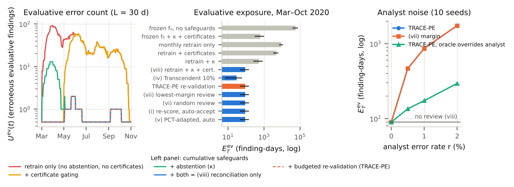
**Fig. 17.** Assurance-plane simulation on the native Dated stream (issuance 1 Mar–30 Sep 2020, horizon 31 Oct; label delay L = 30 d; τ_FPR = 0.5%, τ_FNR = 5%; budget B = 1% of the previous 30 days' issuances; calendar events 1 Apr–1 Oct). Left: daily count of erroneous findings in evaluative states for cumulative safeguards. Centre: total evaluative exposure with 95% day-block bootstrap CIs (log scale). Right: exposure under analyst label noise; reviewed findings are never reconciled under S7 Algorithm 6, so analyst errors persist unless the oracle overrides the analyst at maturity. {MoC}

**Re-validation had nothing left to correct.** Across the seven monthly updates (1 April–1 October), the findings issued in the 30 days before each update numbered 60,092 in scope (not abstained) and 5,141 abstained {MoC}. Full re-scoring by the next model at its own certified threshold flipped 142 verdicts. All 142 were among the abstained findings, so no in-scope verdict changed (K1). Of the 142 flips, 75 were corrective and 67 harmful: 7 malware findings turned benign (0.023% of malware) and 60 benign findings turned malicious (0.174% of benign) {MoC}. Abstention at issue (inductive conformal credibility [15], [16], [102] below κ, set for ≤ 5% abstention on December) had already withheld exactly the findings whose verdicts the next model would change. The re-validation policies then reviewed confident findings that the newer model also confirmed. TRACE-PE's 680 reviews corrected 3 findings (yield 0.44%) against 6 for lowest-margin review (0.88%), so KB1 is not met. E^ev stayed at 90 finding-days for every re-validation policy, (viii) included (K3; Table 11) {MoC}, so none of the corrected findings was held in an evaluative state: all were screening-only. Transcendent's per-class rejection [16] lowers E^ev to 30 by abstaining on twice as many findings (10,614 against 5,466), a coverage trade rather than a correction.

**What does protect issued findings is measurable (A2).** The cumulative ablation in Table 11 and Fig. 17 isolates the safeguards {MoC}:

| Configuration | E^ev_T (finding-days) | Change |
|---|---|---|
| frozen f₀, no safeguards | 56,550 | reference |
| monthly retraining only | 8,730 | −84.6% vs frozen |
| retraining + certificate gating | 4,740 | −45.7% vs retraining only |
| retraining + κ-abstention | 510 | −94.2% vs retraining only |
| retraining + κ-abstention + certificate gating, (viii) | 90 | −98.97% vs retraining only; −99.84% vs frozen |
| frozen f₀ + κ-abstention + certificate gating, (viii-f) | 600 | ×6.7 vs (viii) |

These are A2's components: abstention defines the evidential scope of each finding, and certificates define the time over which its error statement is valid. Applied to a frozen detector, the two safeguards alone reduce E^ev by 98.9% (56,550 → 600); monthly retraining alone reduces it by 84.6% (→ 8,730). The minimum of 90 needs both {MoC}.

**Analyst noise makes review harmful under Algorithm 6 as specified.** S7's reconciliation never lets a matured oracle label override a reviewed finding. With analyst error rates of 0.5%, 1% and 2%, review raises E^ev from 90 to 467, 865 and 1,745 finding-days (10 seeds), for TRACE-PE and margin review alike {MoC}. When matured labels override analyst verdicts, the figures drop to 135, 174 and 295 {MoC}, still above the no-review baseline. Any retained review step must therefore be reconciled against matured labels, and the review budget is exposure-negative unless analyst error is well below 0.5%. KB7 (sign of the yield advantage at r = 2%) is moot, because the advantage is already negative at r = 0.

**Harm gate, streams and sensitivity.** The pre-test replay on 2019 data selected γ = 0.5, the lowest grid value, at both thresholds. Auto-amendment then produced 0 harmful changes among 6,212 in-scope November findings {MoC}. In the simulation no auto-amendment occurred, because no in-scope verdict changed. KS2 holds: the r_H upper bound per update is ≤ 0.058% {MoC}. On prevalence-resampled streams at π = 10% and 5%, all policies have E^ev of 32–39 finding-days, within 3 finding-days of each other at each prevalence {MoC}.

**Label delay and label rate change the picture, but not in A9's favour.** With labels arriving after 60 days, few certificates are still valid at issue (validity horizon A_max = 60 d), so only 1,361 of 68,876 findings are issued as evaluative; after 90 days, none are {MoC}. At L = 60 d, TRACE-PE lowers E^ev by 16.9% [4.7, 29.3] relative to (viii), so K3 would not be met at that delay. The same budget spent on lowest-margin review lowers it by 96.7%, and TRACE-PE without its region selection by 60.4% {MoC}. When only half of the labels ever mature (ρ_L = 0.5), TRACE-PE again changes nothing, while its no-region ablation lowers E^ev by 84.1% {MoC}. K1 and K2 hold in all four scenarios: verdict changes stay ≤ B and the harmful-flip upper bounds ≤ 0.058% {MoC}. Compared with each finding's actual issuer, re-scoring flips fall only among abstained findings at L = 60 d (304) and at ρ_L = 0.5 (218). At L = 90 d, 622 of 626 do; the other 4 turn confident benign findings malicious, and all 4 are screening-only because no certificate is valid at that delay {MoC}. Two conclusions follow. First, region selection, A9's distinctive component, never helps, and it is the reason TRACE-PE trails its own ablation whenever review matters. Second, review itself has value only when labels are slow, and it then works through a baseline the literature already has (margin sampling), not through the A9 policy. The pre-registered decision, taken at L = 30 d, stands.

### 3.7 Attribution leg (dropped by KB10)
**Table 12. Secondary attribution leg: open-set family attribution, unseen-family detection and category back-off**

| Month | Non-generic malware | Unseen share ν_t (%) | Top-1 known (%) | Top-3 known (%) | Top-1 all (%) | Closed-world bound 1 − ν_t (%) | Macro-F1 closed / open (%) | Novelty AUROC | Novelty AUPRC (base rate) | Unknowns rejected (%) | Category acc. / macro-F1 (%) |
|---|---|---|---|---|---|---|---|---|---|---|---|
| Jan 2020 | 4,270 | 7.1 | 77.4 | 95.6 | 71.9 | 92.9 | 71.0 / 71.2 | 0.742 | 0.196 (0.071) | 7.6 | 92.7 / 87.1 |
| Feb 2020 | 3,612 | 9.3 | 78.4 | 84.7 | 71.1 | 90.7 | 65.7 / 66.1 | 0.815 | 0.382 (0.093) | 11.0 | 92.4 / 87.4 |
| Mar 2020 | 4,440 | 10.2 | 72.4 | 80.1 | 65.0 | 89.8 | 67.0 / 67.7 | 0.721 | 0.237 (0.102) | 10.1 | 88.0 / 82.2 |
| Apr 2020 | 4,297 | 10.3 | 77.0 | 86.3 | 69.1 | 89.7 | 66.7 / 67.0 | 0.586 | 0.214 (0.103) | 6.8 | 85.4 / 83.4 |
| May 2020 | 5,357 | 18.3 | 63.7 | 75.6 | 52.0 | 81.7 | 63.9 / 64.3 | 0.445 | 0.203 (0.183) | 2.9 | 77.1 / 76.8 |
| Jun 2020 | 3,938 | 10.5 | 56.4 | 68.0 | 50.5 | 89.5 | 63.9 / 64.2 | 0.572 | 0.246 (0.105) | 2.9 | 61.5 / 69.5 |
| Jul 2020 | 4,783 | 29.1 | 77.1 | 82.6 | 54.7 | 70.9 | 60.2 / 60.2 | 0.804 | 0.671 (0.291) | 2.4 | 81.1 / 77.8 |
| Aug 2020 | 3,366 | 26.4 | 81.3 | 86.1 | 59.8 | 73.6 | 60.8 / 61.9 | 0.813 | 0.589 (0.264) | 12.4 | 92.9 / 86.2 |
| Sep 2020 | 4,287 | 32.8 | 74.5 | 81.6 | 50.1 | 67.2 | 60.9 / 61.2 | 0.799 | 0.593 (0.328) | 9.7 | 89.8 / 82.5 |

LightGBM multiclass over 68 families with ≥ 20 training samples (9,886 files; 3,776 files with generic AV tokens excluded, D8). Open-set rejection at the December 5th-percentile max-probability (τ_open = 0.529). KB10 (July): AUROC 0.804 ≥ 0.80 but AUPRC 0.671 < 3 × 0.291 = 0.874 → kill met, attribution leg dropped. H7: open > closed macro-F1 in 9/9 months, Wilcoxon p = 0.0039, mean +0.42 pp (met; negligible effect). P6: slope of open-set macro-F1 −1.21 pp/month vs detection F1 −2.15 pp/month; difference +0.94 [0.24, 1.64] pp/month, the opposite sign to the prediction → falsified. A first fit with num_leaves = 15, lr = 0.1 diverged (training accuracy 27.5%) and was discarded before any test month was read (D12). {MoC}.

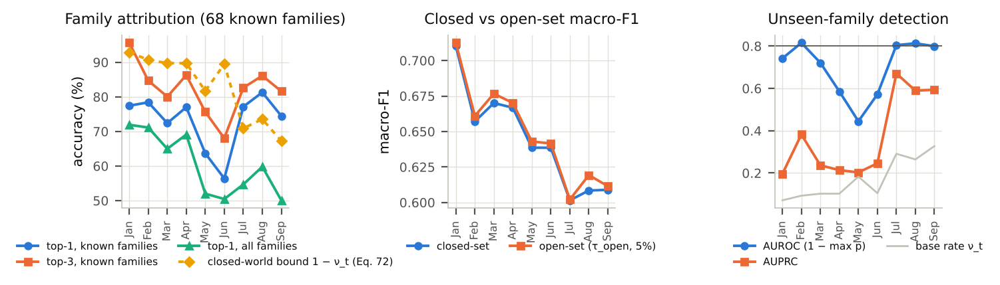
**Fig. 18.** Attribution leg (secondary). LightGBM multiclass on families with ≥ 20 training samples (generic AV tokens excluded, D8); monthly top-k accuracy on known families and on all non-generic malware with the closed-world bound (left), macro-F1 with and without open-set rejection at the December 5th-percentile max-probability threshold (centre), and detection of unseen families by 1 − max p (right). Family labels carry a ±20 pp oracle-uncertainty band (RecMaL [92]). {MoC}

The attribution leg used a LightGBM multiclass model over the 68 families with ≥ 20 training files (9,886 files), after removing 3,776 files that carry generic AV tokens (D8) {MoC}. On known families, top-1 accuracy is 56.4–81.3% and top-3 accuracy 68.0–95.6% across months. Over all non-generic malware, top-1 accuracy falls to 50.1–71.9% against the closed-world bound 1 − ν_t of 67.2–92.9% (Eq. 72) {MoC}. BODMAS [1] reported top-2/top-3 accuracy above 98% for N = 10 known families and about 20–60% over all families {RfP}. With 68 families our known-family figures are lower, which is the direction [1] reported for larger N.

**KB10 kill met.** In July, when unseen families make up 29.1% of non-generic malware, 1 − max-probability separates unseen from known families with AUROC 0.804 but AUPRC only 0.671, below the pre-registered 3 × base-rate bar of 0.874 {MoC}. In May and June the novelty AUROC is 0.445 and 0.572, no better than chance {MoC}. Open-set rejection at the December 5th-percentile threshold rejects 2.4–12.4% of unseen-family files. It raises macro-F1 over closed-set prediction in 9/9 months (p = 0.0039; H7 met), but by only +0.42 pp on average {MoC}. P6 is falsified in the opposite direction: open-set macro-F1 declines more slowly than detection F1 (−1.21 against −2.15 pp per month; difference +0.94 [0.24, 1.64]) {MoC}. The category back-off (trojan, worm, backdoor, other) reaches 61.5–92.9% accuracy {MoC}, but it inherits the same oracle: RecMaL [92] reports that close to 20% of BODMAS family labels are shifted or wrong {RfP}. The attribution leg is dropped from the A2 manuscript and kept as a negative result.

### 3.8 Explanations, ledger integrity and reproducibility
**Table 13. Explanation evidence and ledger integrity (KB11, P8, KB3, V1–V3)**

| EMBER group | Mean abs. grouped SHAP (margin) | Abs. SHAP share (%) | Gain share (%) | LR abs. coefficient share (%) | Mean abs. Δ margin on group deletion |
|---|---|---|---|---|---|
| ByteHistogram | 1.079 | 11.4 | 8.6 | 10.8 | 1.024 |
| ByteEntropyHistogram | 0.272 | 2.9 | 3.2 | 10.0 | 0.307 |
| StringExtractor | 1.142 | 12.0 | 13.7 | 6.5 | 1.087 |
| GeneralFileInfo | 0.385 | 4.0 | 3.6 | 1.1 | 0.272 |
| HeaderFileInfo | 2.674 | 28.1 | 36.6 | 4.3 | 1.700 |
| SectionInfo | 0.749 | 7.9 | 3.1 | 9.3 | 0.668 |
| ImportsInfo | 0.796 | 8.4 | 9.7 | 52.8 | 0.605 |
| ExportsInfo | 0.002 | 0.0 | 0.0 | 2.6 | 0.000 |
| DataDirectories | 2.403 | 25.3 | 21.6 | 2.7 | 1.134 |

| Check | Result |
|---|---|
| Grouped TreeSHAP cost | 4.09 ms per finding; local accuracy max residual 4.3e-14 |
| Deletion faithfulness (Spearman, SHAP rank vs Δ margin) | mean 0.62, median 0.70 |
| KB11 stability (top-3 group Jaccard across seeds) | correct 0.906 vs wrong 0.856 (n = 373); Cliff's δ = 0.168 ≥ 0.147 → gate allowed |
| Issued-finding records (ISS) | 77,417 records with monthly epoch anchors (341 s) |
| V1 chain verification | 211,960 records verified in 2.13 s |
| V2 content-addressed objects | 28 objects, 0 failures |
| V3 re-execution (1,000 sampled findings) | vector hash 1,000/1,000; margin bit-identical 1,000/1,000; SHAP local accuracy 1,000/1,000 |
| P8 tamper injection | bit flip 10,000/10,000; deletion 10,000/10,000; insertion 10,000/10,000; swap 10,000/10,000; timestamp edit 10,000/10,000; actor edit 10,000/10,000 |
| P8 verification scaling | n = 1,000: 0.0015 s; n = 10,000: 0.0218 s; n = 100,000: 0.1356 s; n = 1,000,000: 1.4649 s; log–log slope 0.973 ∈ [0.9, 1.1] |
| KB3 cross-environment re-execution | tree hash, 97,436 scores, 134,435-vector digest identical (100.0%); container Python 3.13.16 / NumPy 2.5.3 vs device Python 3.10.12 / NumPy 2.2.6, LightGBM 4.7.0 on both |
| Acquisition | 134,435 ACQ records; 7 duplicate groups; oracle Merkle root 7dcfe2a8d1c034ff… |

Grouped TreeSHAP: exact LightGBM pred_contrib summed over EMBER v2 groups, 6,020 month×class-stratified March–September findings. The anchor signature is Ed25519 with a simulated timestamping authority; WORM storage is emulated by a content-addressed write-once store. {MoC}.

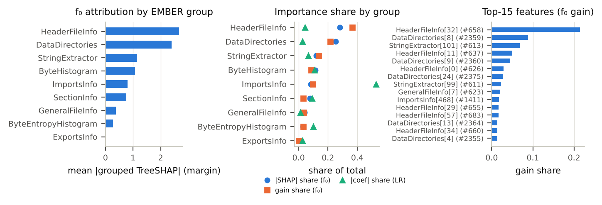
**Fig. 13.** Feature importance of f₀. Left: mean absolute grouped TreeSHAP (exact, LightGBM pred_contrib) per EMBER v2 group on 6,020 month×class-stratified March–September findings. Centre: share of importance per group under three measures (|SHAP|, LightGBM gain, LR |coefficient| on signed-log standardised inputs). Right: top-15 features by gain; index = EMBER v2 column, offset = position inside its group. {MoC}

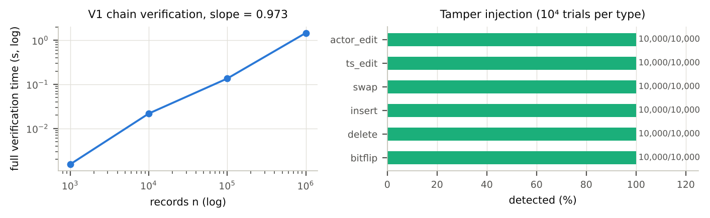
**Fig. 19.** Evidence-ledger integrity (P8): wall-clock time of a full hash-chain verification for n ∈ {10³, …, 10⁶} records (left; log–log slope) and detection of injected modifications in a 2,000-record chain (right). {MoC}

**What f₀ relies on.** Exact grouped TreeSHAP [124] (local-accuracy residual ≤ 4.3 × 10⁻¹⁴) attributes 28.1% of the mean absolute margin contribution to HeaderFileInfo and 25.3% to DataDirectories. StringExtractor (12.0%) and ByteHistogram (11.4%) follow {MoC}. LightGBM gain ranks the same groups first (36.6% and 21.6%). The single strongest feature is a hashed bin of the DLL-characteristics flags (#658, 21.5% of gain). The next two DataDirectories features are the size and file offset of the certificate table (#2359, #2360; 8.8% and 4.5% of gain), i.e. whether the file carries an Authenticode signature {MoC}. The linear model, by contrast, puts 52.8% of its coefficient mass on ImportsInfo {MoC}. The two model families read different evidence, which is part of why their low-FPR behaviour differs. Explanations are hashed features, not semantics: a hashed bin aggregates several flag strings, and the attribution identifies a bin, not a flag.

**Faithfulness and stability (KB11).** Replacing a group by its benign median changes the margin in the order SHAP predicts (mean per-finding Spearman 0.62, median 0.70) {MoC}. Top-3 group sets are more stable across the five seeds for correct findings (Jaccard 0.906) than for wrong ones (0.856, n = 373). Cliff's δ = 0.168 clears the pre-registered 0.147, so explanation stability may serve as a secondary gate {MoC}. This is a small effect, and S7 recorded that stability is not faithfulness. Post-hoc explanations can also be manipulated [136].

**Ledger integrity (P8) and verifiability.** The chain links records by domain-separated SHA-256 [130] with monthly Merkle roots [111] signed by Ed25519 [129]. Ten thousand injections of each of six tamper types (bit flip, deletion, insertion, swap, timestamp edit, actor edit) into a 2,000-record chain were all detected: 60,000/60,000 {MoC}. Full verification time is linear in chain length (log–log slope 0.973; 10⁶ records in 1.46 s, about 1.5 µs per record) {MoC}. The S10 evidence ledger carried 77,417 issued-finding (ISS) records with monthly epoch anchors and verified end to end (V1: 211,960 records in 2.13 s). All 28 content-addressed objects re-hashed correctly (V2). For 1,000 randomly drawn findings, re-execution reproduced the vector hash, the bit-identical margin and the SHAP local-accuracy check in 1,000/1,000 cases (V3) {MoC}. After the TRG, CERT, RVC and REPORT records were appended and every open epoch anchored, the sealed chain of 212,277 records verified in 2.30 s (V1; 10.9 µs per record, against 1.5 µs for the smaller synthetic records of the scaling test, because S10 records carry full finding metadata) and all 39 content-addressed objects re-hashed correctly (V2) {MoC}.

**Cross-environment reproducibility (KB3).** Retraining f₀ on the user's machine (Python 3.10.12, NumPy 2.2.6) and in the container (Python 3.13.16, NumPy 2.5.3), both with LightGBM 4.7.0, gave the identical tree-section hash (b3c4ba02…eb52) and bit-identical scores for all 97,436 evaluation rows. The 134,435-vector digest also matched {MoC}. Model identity defined by the tree section, not the model file, survives an environment change. This is the property an opposing expert needs to re-run a finding.

### 3.9 EMBER-2018 corroboration
**Table 14. EMBER-2018 corroboration (D10)**

| Published EMBER-2018 model on Nov–Dec 2018 | Release notebook {RfP} (full test set) | This vectorisation {MoC} (stratified sub-sample) | Δ (pp) |
|---|---|---|---|
| AUC-ROC (%) | 99.643 | 99.659 | +0.016 |
| TPR at 0.1% FPR, test-tuned (%) | 86.81 | 85.49 | −1.32 |
| TPR at 1% FPR, test-tuned (%) | 96.50 | 96.23 | −0.26 |

| Month | Benign / malware | FNR @θ0.1% (%) | FPR @θ0.1% (%) | F1 @π=10%, θ0.1% (%) | FNR @θ0.5% (%) | FPR @θ0.5% (%) | AUC-ROC (%) |
|---|---|---|---|---|---|---|---|
| May–Jun 2018 (cal) | 5,898 / 6,054 | 51.72 | 0.017 | 65.06 | 28.10 | 0.339 | 98.666 |
| Jul 2018 | 3,066 / 2,969 | 52.48 | 0.033 | 64.30 | 27.89 | 0.457 | 99.071 |
| Aug 2018 | 3,098 / 3,042 | 59.50 | 0.032 | 57.53 | 33.23 | 0.226 | 98.343 |
| Sep 2018 | 3,050 / 2,918 | 72.48 | 0.066 | 42.96 | 42.70 | 0.492 | 97.385 |
| Oct 2018 | 2,941 / 2,970 | 61.48 | 0.272 | 54.65 | 36.03 | 1.156 | 97.198 |
| Nov 2018 | 2,995 / 2,983 | 58.13 | 0.100 | 58.65 | 31.01 | 0.835 | 97.556 |
| Dec 2018 | 3,012 / 2,938 | 66.68 | 0.066 | 49.76 | 38.97 | 1.162 | 96.665 |

| Corroboration check | Result |
|---|---|
| Within-EMBER temporal AUT(F1@π=10%) (%), θ@0.1% / θ@0.5% | 54.17 / 75.60 |
| SVR at (0.5%, 5%), Jul–Dec 2018 | θ@0.1%: 0/6; θ@0.5%: 0/6 |
| Random-split inflation (5 seeds), F1@π=10% vs temporal AUT | +19.86 pp [18.17, 21.81] |
| Forward transfer: EMBER-trained (Jan–Apr 2018) → BODMAS Mar–Sep 2020, AUT(F1@π=10%) (%) | 77.61; monthly FNR 22.4–58.3% |
| Backward application: f₀ (BODMAS 2019) → EMBER 2018, monthly AUC-ROC (C1-violating, descriptive) | 73.4–93.0% |
| SHA-256 overlap between the EMBER sub-sample and BODMAS | 4 files |

Month-stratified sub-sample of the EMBER-2018 labelled release vectorised with the EMBER v2 extractor (72,009 files, about 3,000 per class per month). Within-EMBER protocol mirrors TRACE-PE: train January–April, calibrate May–June (CP-certified θ), test July–December monthly. The release-notebook values are computed on the full 200,000-file test set with test-tuned thresholds; ours on the stratified Nov–Dec sub-sample.

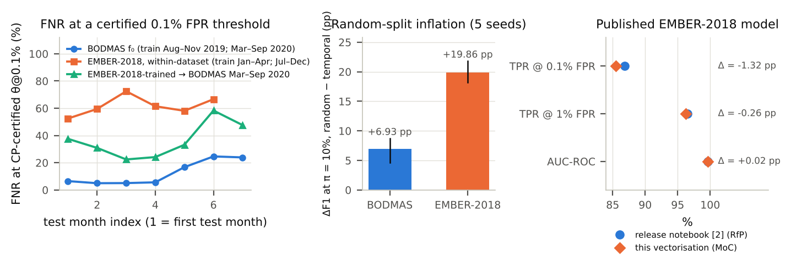
**Fig. 21.** EMBER-2018 corroboration (D10). Left: FNR at a CP-certified 0.1% FPR threshold by test month for f₀ on BODMAS, for the same pipeline trained and tested inside EMBER-2018 (month-stratified sub-sample), and for the EMBER-trained detector applied forward to BODMAS 2020. Centre: random-split inflation of F1 at π = 10% over the temporal AUT (5 seeds; 95% CI). Right: pipeline check with the published EMBER-2018 model, release-notebook values (full test set) versus this vectorisation (stratified sub-sample). {measured-on-Claude (orange/centre/left); reproduced from the EMBER release notebook (blue dots, right)}

**The vectorisation is sound.** On a month-stratified EMBER-2018 sub-sample (72,009 files, about 3,000 per class per month) vectorised with the EMBER v2 extractor, the published EMBER-2018 LightGBM model reproduces the dataset release's own figures. AUC-ROC on November–December is 99.659% against 99.643%. With test-tuned thresholds, TPR is 85.49% against 86.81% at 0.1% FPR and 96.23% against 96.50% at 1% FPR (Table 14) {MoC vs RfP}. The −1.32 pp gap at 0.1% FPR is of the size expected when a 0.1% threshold rests on about six false positives among the sub-sample's 6,007 benign files.

**Certificates are harder to earn on EMBER-2018.** The TRACE-PE pipeline trained on January–April 2018 (24,075 files) and certified on May–June misses 52.5–72.5% of malware per month at θ@0.1% and 27.9–42.7% at θ@0.5% {MoC}. At θ@0.5% the realised FPR also exceeds 0.5% in October–December (0.835–1.162%). No month is valid at (0.5%, 5%) at either threshold {MoC}. The same protocol that certified four BODMAS months certifies none here. A certificate is a property of a detector and a data stream, not of a pipeline.

**Bias and transfer.** Random splitting inflates F1 at π = 10% by +19.86 pp (95% CI 18.17–21.81) on EMBER-2018, against +6.93 pp on BODMAS {MoC}. The EMBER-trained detector applied forward to BODMAS March–September 2020, with its threshold certified on BODMAS December 2019, reaches AUT(F1 at π = 10%) 0.776 and monthly FNR 22.4–58.3% {MoC}. Applying f₀ backward to EMBER-2018 gives monthly AUC-ROC of only 73.4–93.0%. This violates C1 and is reported descriptively {MoC}. Four SHA-256 values occur in both collections {MoC}.

### 3.10 Computational cost and learning curves
**Table 16. CPU cost per model (uncontended, sequential)**

| Model | Training (s) | Inference (µs per file) | Peak RSS (GB) |
|---|---|---|---|
| EMBER-2018 GBDT (published model) | 0.0 | 335.5 | 1.17 |
| Gaussian NB | 1.3 | 41.6 | 1.63 |
| LR + χ²(256) | 2.1 | 21.6 | 1.78 |
| LR | 3.1 | 25.9 | 1.63 |
| k-NN (PCA-50) | 3.9 | 81.5 | 1.63 |
| LR + IG(256) | 4.7 | 26.9 | 1.57 |
| LR + PCA(0.95) | 16.2 | 52.5 | 2.11 |
| RBF-SVM (PoC, 10k) | 26.7 | 3,306.2 | 1.80 |
| MLP (PoC, 20k) | 26.7 | 54.9 | 1.67 |
| Extra trees | 29.1 | 53.5 | 1.00 |
| LGBM-TRACE (f₀ family) | 35.8 | 13.4 | 1.39 |
| Random forest | 53.5 | 40.7 | 0.98 |
| LR + mRMR(128) | 76.3 | 17.3 | 1.83 |
| Linear SVM | 78.1 | 32.3 | 2.38 |
| XGBoost | 82.2 | 9.9 | 1.81 |
| Temporal stacking | 121.7 | 69.9 | 1.90 |
| LGBM-EMBER | 151.7 | 102.5 | 2.37 |

Training window 23,158 × 2,381 (S7); inference on 20,000 rows. Intel Xeon @ 2.10 GHz, 2 vCPU, Python 3.13.16, LightGBM 4.7.0, XGBoost 3.4.1, scikit-learn 1.9.1. One run per model; the published EMBER-2018 model is scored only; RBF-SVM values come from its E1 run (10,000-row training sub-sample, 97,436 rows scored); the MLP was re-timed after D17. {MoC}.

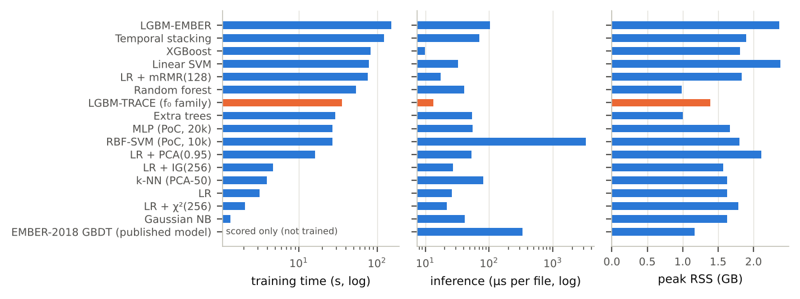
**Fig. 14.** CPU cost per model on the S7 training window (23,158 × 2,381; 2 vCPU Intel Xeon 2.1 GHz): wall-clock training time, inference time per file (20,000 evaluation rows) and process peak RSS, from an uncontended sequential timing run (one seed per model). The published EMBER-2018 model is scored only. RBF-SVM: E1 run on its 10,000-row sub-sample. {MoC}

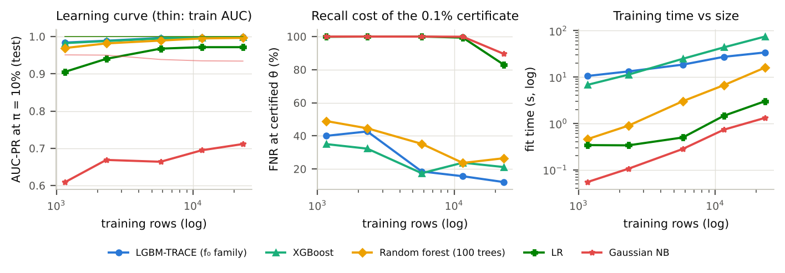
**Fig. 15.** Learning curves on stratified sub-samples (5–100%) of the training window, evaluated on the pooled March–September 2020 stream: AUC-PR at π = 10% (thick) with in-sample training AUC (thin), FNR at the CP-certified 0.1% threshold fitted on December, and wall-clock fit time. {MoC}

**Everything fits a 2-vCPU, 8 GB budget.** In an uncontended sequential run, LGBM-TRACE trains in 35.8 s on 23,158 × 2,381 rows and scores 13.4 µs per file. Its peak resident memory is 1.39 GB {MoC}. LGBM-EMBER (2,048 leaves, 1,000 rounds) costs 151.7 s and 102.5 µs per file, and XGBoost 82.2 s and 9.9 µs; temporal stacking is the slowest trained model at 121.7 s {MoC}. No model exceeded 2.38 GB. Grouped TreeSHAP adds 4.09 ms per finding, and ledger verification 1.5 µs per synthetic record and 10.9 µs per record of the sealed S10 ledger {MoC}. Evidential overhead is small next to model fitting. Issuing all 77,417 test findings, with scoring, grouped TreeSHAP, credibility, ISS records and monthly anchors, took 341 s, i.e. 4.4 ms per finding, 93% of it TreeSHAP {MoC}; a month of at most 12,399 findings therefore costs under a minute {Est, from the measured per-finding cost}. The queued steps of the S10 run (5-seed zoos, assurance simulation, bias experiments, EMBER-2018 corroboration, tables and figures) took 4.65 h of summed wall-clock on this machine, counting re-runs after out-of-memory kills, the MLP scorer fix and one container restart {MoC}. Steps outside the queues are excluded: data initialisation, the EMBER-2018 sub-sampling and vectorisation (118 s for 72,009 files) and the cross-environment check on a second computer.

**The certified operating point is data-hungry.** On stratified sub-samples of the training window, AUC-PR at π = 10% of LGBM-TRACE barely moves (98.39% at 1,158 rows, 99.79% at 23,158). FNR at the certified 0.1% threshold falls from 40.0% to 12.06% over the same range (Fig. 15) {MoC}. Linear models stay above 82% FNR at every size {MoC}. The learning curve has not flattened at the full window, which is consistent with the stronger low-FPR recall of the published EMBER-2018 model trained on far more data, and with the PreWindow gain in Section 3.4. Fit times in Fig. 15 come from a sequential re-run with no concurrent job. At the full window they are within 10% of Table 16 (LGBM-TRACE 33.9 s vs 35.8 s, XGBoost 74.7 s vs 82.2 s) {MoC}; the learning-curve forest has 100 trees against 300 in Table 16, so its times are not comparable.

### 3.11 Statistical comparison of detectors
**Table 17. Statistical comparison of detectors (U13/H5)**

| Model | Mean monthly ΔF1@π=10%, LGBM-TRACE (seed mean) − model (pp) | Cliff's δ | Wilcoxon p | Holm p | McNemar vs f₀: f₀-only / model-only errors | Months with DeLong p_Holm < 0.05 vs f₀ |
|---|---|---|---|---|---|---|
| EMBER-2018 GBDT (published model) | −3.70 | −0.306 | 0.078 | 0.219 | 2,990 / 2,288 (p = 4.3e-22) | 2/7 |
| Extra trees | +1.34 | +0.265 | 0.219 | 0.219 | 652 / 2,448 (p = 1.0e-242) | 0/7 |
| LGBM-EMBER | −2.13 | −0.429 | 0.016 | 0.219 | 516 / 477 (p = 0.228) | 2/7 |
| LR | +63.06 | +1.000 | 0.016 | 0.219 | 176 / 23,343 (p = 0.0e+00) | 6/7 |
| LR + χ²(256) | +38.59 | +1.000 | 0.016 | 0.219 | 165 / 17,103 (p = 0.0e+00) | 7/7 |
| LR + IG(256) | +88.74 | +1.000 | 0.016 | 0.219 | 40 / 28,461 (p = 0.0e+00) | 7/7 |
| LR + mRMR(128) | +43.38 | +1.000 | 0.016 | 0.219 | 185 / 18,211 (p = 0.0e+00) | 7/7 |
| MLP (PoC, 20k) | +56.68 | +1.000 | 0.016 | 0.219 | 256 / 18,159 (p = 0.0e+00) | 6/7 |
| Gaussian NB | +71.82 | +1.000 | 0.016 | 0.219 | 47 / 25,404 (p = 0.0e+00) | 7/7 |
| Random forest | +5.23 | +0.510 | 0.016 | 0.219 | 96 / 4,478 (p = 0.0e+00) | 3/7 |
| Temporal stacking | −3.25 | −0.510 | 0.016 | 0.219 | 834 / 75 (p = 6.9e-163) | 2/7 |
| Linear SVM | +80.14 | +1.000 | 0.016 | 0.219 | 103 / 26,982 (p = 0.0e+00) | 7/7 |
| RBF-SVM (PoC, 10k) | +36.32 | +1.000 | 0.016 | 0.219 | 121 / 16,270 (p = 0.0e+00) | 7/7 |
| XGBoost | +5.55 | +0.510 | 0.016 | 0.219 | 237 / 3,201 (p = 0.0e+00) | 0/7 |

| Test | Result |
|---|---|
| Friedman over 7 months | χ² = 94.97, p = 4.3e-14, Kendall W = 0.969 |
| Mean ranks (1 = best) | Temporal stacking 1.57; EMBER-2018 GBDT (published model) 2.29; LGBM-EMBER 2.57; LGBM-TRACE (f₀ family) 4.00; Extra trees 4.57; Random forest 6.43; XGBoost 6.57; RBF-SVM (PoC, 10k) 8.57; LR + χ²(256) 9.00; LR + mRMR(128) 9.57; MLP (PoC, 20k) 11.57; LR 11.86; Gaussian NB 12.57; Linear SVM 13.86; LR + IG(256) 15.00 |

Monthly F1 at π = 10% and the certified 0.1% threshold, March–September 2020 (n = 7 months; seeds averaged before testing; single-fit models use their one fit; kNN and LR + PCA are excluded from the Friedman test because F1 is undefined when no file is flagged). McNemar and DeLong compare against f₀ (seed 11) and the first seed of each model; DeLong p-values are Holm-adjusted over all model × month tests. With n = 7 the smallest two-sided Wilcoxon p is 0.0156, so no pairwise comparison can pass Holm correction over 14 comparisons (minimum 0.219): a power limit of the month-level design, not evidence of equivalence. McNemar uses the pooled March–September verdicts. {MoC}.

Following Demšar [140], the Friedman test over the seven monthly F1 values at π = 10% rejects equal performance (χ² = 94.97, p = 4.3 × 10⁻¹⁴) with a large concordance (Kendall W = 0.969) {MoC} [146], [147]. Mean ranks place temporal stacking first (1.57), the published EMBER-2018 GBDT second (2.29) and LGBM-EMBER third (2.57); LGBM-TRACE is fourth (4.00), and every tree ensemble ranks ahead of every linear and proof-of-concept model (H5 met) {MoC}. Pairwise, LGBM-TRACE (seed mean) beats every linear model and NB in 7/7 months (Cliff's δ = +1.000 [142]), and random forest and XGBoost by 5.2–5.6 pp in mean monthly F1 (δ = +0.51) {MoC}. With n = 7 months the smallest attainable two-sided Wilcoxon p is 0.0156, which Holm's correction [141] over fourteen comparisons lifts to 0.219. No pairwise month-level test can reach 0.05 here; this is a power limit of the design, not evidence of equivalence. Finding-level exact McNemar tests [145] on the pooled verdicts separate almost every pair. f₀ makes fewer errors than every comparator except temporal stacking (834 f₀-only against 75; p = 6.9 × 10⁻¹⁶³) and the published EMBER-2018 GBDT (2,990 against 2,288; p = 4.3 × 10⁻²²), and it is indistinguishable from LGBM-EMBER (p = 0.228) {MoC}. DeLong tests [144] per month separate f₀'s AUC from the linear and proof-of-concept models in 6–7 of 7 months, and from the other tree ensembles in 0–3 months {MoC}.

---

## 4. Comparison with existing methods and published baselines
**Table 15. Comparison with existing methods and published baselines: absolute (pp) and relative differences**

| Metric | Published source | Published value | This work | Δ absolute (pp) | Δ relative | Protocol note |
|---|---|---|---|---|---|---|
| Monthly F1 (%), range | [1] T. II, EMBER-GBDT | 92.14–97.76 {RfP} | 98.09–99.51 {MoC} | +5.95 / +1.75 | +6.5% / +1.8% | [1]: GBDT trained by [1] on EMBER (5 seeds), threshold at 0.1% FPR on its own validation split, Oct 2019–Sep 2020; ours: the published EMBER-2018 model file, threshold at the 0.1% empirical quantile of BODMAS Dec 2019 benign, Mar–Sep 2020 Dated (realised pooled FPR 0.193%) |
| Monthly F1 (%), range | [1] T. II, EMBER-GBDT | 92.14–97.76 {RfP} | 88.65–98.27 {MoC} LGBM-TRACE, 5-seed mean | −3.49 / +0.51 | −3.8% / +0.5% | LGBM-TRACE trained on BODMAS Aug–Nov 2019 at [1]'s operating point (0.1% empirical on Dec 2019) |
| Monthly F1 (%), range | [1] T. II, EMBER-GBDT | 92.14–97.76 {RfP} | 82.93–96.82 {MoC} LGBM-TRACE, 5-seed mean | −9.21 / −0.94 | −10.0% / −1.0% | LGBM-TRACE at the CP-certified 0.1% threshold (k* = 1) |
| Monthly F1 (%), range | [1] T. II, SOREL-GBDT | 95.70–98.94 {RfP} | 82.93–96.82 {MoC} LGBM-TRACE, 5-seed mean | −12.77 / −2.12 | −13.3% / −2.1% | SOREL-20M-trained GBDT ([1]) vs LGBM-TRACE certified |
| Monthly FNR (%), range | [1] T. III | 1.71–7.23 {RfP} | 1.91–20.45 {MoC} | +0.20 / +13.22 | +11.5% / +182.9% | T0 replication, Dated: [1]'s protocol on our strata |
| Monthly FPR (%), range | [1] T. III | 0.00–0.51 {RfP} | 0.000–0.108 {MoC} | +0.00 / −0.40 | — / −78.9% | T0 replication, Dated |
| Max monthly FNR, unseen families (%) | [1] T. III | 43.04 {RfP} | 42.17 {MoC} | −0.87 | −2.0% | T0 replication, Dated |
| Monthly FNR (%), range | [1] T. III | 1.71–7.23 {RfP} | 1.19–3.43 {MoC} | −0.52 / −3.80 | −30.5% / −52.6% | T0 replication, Dated + PreWindow: [1]'s protocol on our strata |
| Monthly FPR (%), range | [1] T. III | 0.00–0.51 {RfP} | 0.000–0.119 {MoC} | +0.00 / −0.39 | — / −76.6% | T0 replication, Dated + PreWindow |
| Max monthly FNR, unseen families (%) | [1] T. III | 43.04 {RfP} | 29.09 {MoC} | −13.95 | −32.4% | T0 replication, Dated + PreWindow |
| Monthly FNR (%), range | [1] T. III | 1.71–7.23 {RfP} | 5.07–29.05 {MoC} LGBM-TRACE, 5-seed mean | +3.36 / +21.82 | +196.7% / +301.9% | LGBM-TRACE certified, Jan–Sep 2020 |
| F1 (%), random split | [1] T. II, EMBER-GBDT validation | 98.62 {RfP} | 98.03 {MoC} LGBM-TRACE random arm, 5 seeds | −0.59 | −0.6% | random split inflates both; ours: BODMAS random 5-seed arm |
| F1 (%) | [94] D3QN, BODMAS | 98.64 {RfP} | 90.98 {MoC} LGBM-TRACE temporal AUT, 5-seed mean | −7.66 | −7.8% | [94] reports no temporal split; ours: temporal AUT, native ratio |
| F1 (%) | [94] D3QN, EMBER-2018 | 85.07 {RfP} | 75.60 {MoC} within-EMBER AUT, θ@0.5% | −9.47 | −11.1% | different protocol; π = 10% re-weighting |
| AUC-ROC (%) | EMBER-2018 release notebook [2] | 99.64 {RfP} | 99.66 {MoC} | +0.02 | +0.0% | same published model; full test set vs our stratified sub-sample |
| TPR at 0.1% FPR (%) | EMBER-2018 release notebook [2] | 86.81 {RfP} | 85.49 {MoC} | −1.32 | −1.5% | test-tuned threshold in both |
| TPR at 0.1% FPR (%) | [2] EMBER-2017 LightGBM | 92.99 {RfP} | 84.12 {MoC} LGBM-TRACE, 5-seed mean | −8.87 | −9.5% | EMBER-2017 test set, test-tuned threshold, vs LGBM-TRACE on BODMAS Mar–Sep 2020 at a threshold fixed on December 2019 |
| Malware regressing after an update (%) | [30] Ghiani, Android CL | 3.00–6.00 {RfP} | 0.023 {MoC} naive re-scoring | −2.98 / −5.98 | −99.2% / −99.6% | [30]: continual-learning Android detectors; ours: monthly full retraining of LGBM-TRACE, BODMAS PE, findings of the 30 d before each of 7 updates, certified 0.5% thresholds, abstained findings included |
| Goodware flips per update (%) | [89] Kozák, full AT | 1.22 {RfP, computed from counts} | 0.174 {MoC} naive re-scoring | −1.046 | −85.8% | [89]: EMBER-GBDT after full adversarial retraining; ours: benign findings turned malicious by the next monthly model |
| Malware flips per update (%) | [89] Kozák, full AT | 0.18 {RfP, computed from counts} | 0.023 {MoC} naive re-scoring | −0.157 | −87.3% | as above, malware findings turned benign; [89] denominator uncertain (27/14,997 = 0.18% as in S6; 27/1,785 = 1.51%) |

Δ = this work − published; relative Δ = Δ / published. Ranges are compared end-to-end (lower/upper). Protocols differ in training data, test months, base rate and operating point, as stated per row; rows with matched protocol are the release-notebook rows (same EMBER-2018 model file) and the T0 replication. LGBM-TRACE values are 5-seed means. {RfP} = reproduced-from-paper or release artifact; {MoC} = measured-on-Claude.

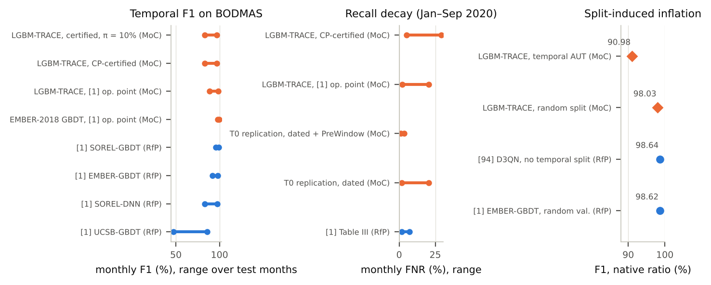
**Fig. 20.** Comparison with published results. Blue: reproduced-from-paper (RfP) values as reported (BODMAS [1] Tables II–III; D3QN [94]); orange: measured-on-Claude (MoC) under this paper's protocol (Dated stratum; thresholds fitted on December 2019; months March–September 2020 for F1, January–September for FNR; LGBM-TRACE values are 5-seed means). Protocols differ (training data, months, operating point), so the comparison shows magnitudes, not a like-for-like ranking; the T0 rows replicate [1]'s Table III protocol on our strata. Right: dot plot (axis does not start at zero). {reproduced-from-paper (blue); measured-on-Claude (orange)}

Absolute differences are in percentage points (this work − published), relative differences are Δ divided by the published value. Every row states its protocol mismatch; only the release-notebook rows (same model file) and the T0 replication of [1]'s Table III protocol are like-for-like.

**Operating point versus model.** BODMAS Table II [1] reports monthly F1 of 92.14–97.76% for an EMBER-trained GBDT thresholded at 0.1% FPR on its own validation split {RfP}. Under our protocol the published EMBER-2018 model, thresholded on BODMAS December 2019 benign files, reaches 98.09–99.51% (+5.95/+1.75 pp; +6.5%/+1.8%) {MoC}. The gain is bought with an FPR budget overrun: realised pooled FPR is 0.193% against the 0.1% target {MoC}. LGBM-TRACE at the same empirical operating point spans 88.65–98.27% (−3.49/+0.51 pp). At the CP-certified threshold, which keeps realised FPR at 0.008%, it spans 82.93–96.82% (−9.21/−0.94 pp; −10.0%/−1.0%), and 12.77/2.12 pp below [1]'s SOREL-GBDT range {MoC vs RfP}. Against the empirical threshold, the certificate costs LGBM-TRACE 1.45–9.04 pp of monthly F1 (seed means) {MoC}. In return the FPR statement holds, which an uncertified threshold does not deliver (Section 3.2).

**Recall decay.** BODMAS Table III [1] reports monthly FNR of 1.71–7.23% for a GBDT trained before October 2019 and thresholded on a random 80:20 validation split {RfP}. LGBM-TRACE at the certified threshold shows 5.07–29.05% (seed means, January–September; +3.36/+21.82 pp) {MoC}. Our T0 replication with [1]'s data composition gives 1.19–3.43% (−0.52/−3.80 pp; −30.5%/−52.6%) for LGBM-EMBER, so [1]'s Table III magnitudes are reproducible on the released vectors {MoC vs RfP}. Most of the gap comes from July–September, months that [1]'s Table III also covers. The decay in Table 3 is therefore no artefact of our split. It reflects the different training window, the certified threshold and our Dated stratum, which removes the batch-dated benign files.

**Split-induced inflation in published figures.** D3QN feature selection [94] reports F1 98.64% on BODMAS with no temporal split {RfP}. Our random-split arm gives 98.03% and our temporal AUT 90.98% (native ratio, seed means) {MoC}. The published value sits 0.61 pp above our random-split figure and 7.66 pp (7.8%) above the temporal one, i.e. where a random split puts it. On EMBER-2018 the corresponding gap to our within-EMBER temporal AUT at θ@0.5% is 9.47 pp (−11.1%) {MoC vs RfP}. [1]'s random-validation F1 of 98.62% and our random-split 98.03% agree within 0.59 pp {RfP vs MoC}. The inflation measured in Section 3.4 (+6.93 pp) is the size of the error a reader inherits from random-split figures.

**Regression after updates.** Ghiani et al. [30] report that up to 3–6% of malware regress after continual-learning updates of Android detectors {RfP}. Kozák et al. [89] count 73 goodware flips among 5,983 goodware (1.22%) after full adversarial retraining of an EMBER-GBDT {RfP, computed from counts}. Monthly full retraining of LGBM-TRACE on BODMAS, scored at each model's certified 0.5% threshold, regressed 0.023% of malware findings and flipped 0.174% of benign findings, abstained findings included: 2.98–5.98 pp (99.2–99.6%) and 1.05 pp (85.8%) below the published rates {MoC vs RfP}. The settings differ in platform, update mechanism and threshold. What the comparison shows is that regression under certified thresholds and monthly GBDT retraining is rare, and that it concentrates in findings an evidential pipeline would not have issued as confident.

**Pipeline validity.** On the same published EMBER-2018 model file, our vectorisation reproduces the release values within +0.02 pp AUC-ROC and −1.32/−0.26 pp TPR at 0.1%/1% FPR {MoC vs RfP}. LGBM-TRACE's pooled TPR at the certified 0.1% threshold (84.12%) is 8.87 pp (9.5%) below the EMBER-2017 LightGBM's 92.99% at a test-tuned 0.1% FPR [2] {RfP}. That gap is in the expected direction for a threshold fixed months earlier, against one tuned on the test set itself.

---

## 5. Discussion
**5.1 What the evidence supports.** The measurements support three statements an evidence framework can defend.
1. **A detector's error statement is time-indexed and must expire.** At a fixed certified threshold, f₀'s FPR stayed within its certificate in every month while its FNR certificate held from March to June and failed from July (Table 4). A static split would have reported 1.58% FNR for every month (KB4), and an uncertified empirical threshold overran its FPR budget in 5.1% of model-months, including six of seven months for a widely used public model (Section 3.2) {MoC}.
2. **Evidential safeguards at issue time outweigh after-the-fact review.** Abstention on low-credibility findings and certificate gating together cut evaluative exposure by 98.97% relative to monthly retraining alone (Table 11). Budgeted re-validation of the remaining findings cut nothing, because the abstained set already contained every finding a newer model would change {MoC}.
3. **The integrity layer is cheap and verifiable.** Tamper evidence was complete (60,000/60,000), verification is linear in chain length (10.9 µs per record on the 212,277-record S10 ledger), and findings re-execute bit-identically across environments (KB3, V3) {MoC}.

These three statements are the A2 manuscript: time-indexed certificates plus the hash-chained evidence ledger, with abstention as the scope rule that connects them.

**5.2 Why A9 failed, mechanistically.** The A9 premise was that drift-driven model updates silently change the truth value of issued findings and that an analyst budget is needed to catch them. On BODMAS that premise fails for a specific reason. ICE credibility at issue time measures how typical a finding's non-conformity is relative to December calibration data. Findings near the decision boundary have low credibility, are abstained, and at L = 30 d are also the only findings whose verdict a retrained model changes. All 142 re-scoring flips over seven updates fell in the abstained set (Section 3.6) {MoC}. Abstention and verdict instability are two views of one quantity, the distance from the boundary relative to calibration data. A selective issuer therefore pre-empts the changes that re-scoring by the next model makes. Only at L = 90 d, when findings are re-scored by a model up to three updates newer than their issuer, do 4 of 626 flips reach confident findings, all of them screening-only {MoC}. The confident errors that remain are errors on which successive models agree: no in-scope verdict changed at any update, so every confident miss of an issuer was also missed by the next retrained model. For f₀ the July–September misses are mostly wabot, ceeinject and zbot variants (Table 9). Re-scoring with the next model cannot find such errors; only labels can. This is a substantive negative result for the premise, drawn from the flip literature [28], [30], [89], that model updates silently invalidate issued findings. Under certified thresholds with abstention, flips do not reach evaluative findings. Review recovers exposure only when labels are slow (L = 60 d), and then plain lowest-margin review outperforms TRACE-PE's region-scoped selection (Section 3.6) {MoC}.

**5.3 Threshold choice matters more than model choice.** Within the tree ensembles, the AUT spread between models (0.853–0.947) is only about twice the spread across LGBM-TRACE seeds (0.890–0.933) {MoC}. The spread across threshold rules for one model is larger. f₀'s pooled TPR is 87.94% at the certified 0.1% threshold, 90.19% at the empirical one and 99.39% at p = 0.5, while precision at π = 1% is 99.08%, 98.80% and 64.38% respectively {MoC}. The same holds across protocols. With [1]'s lower empirical threshold, July–September FNR is 1.88–2.64%, but realised FPR overruns the 0.1% budget in up to 7 of 12 months; with the certified threshold, FPR stays at least 3.5 times below budget and FNR reaches 16.76–24.64% {MoC}. Certification has a recall price that falls as the calibration set grows. With 6,120 December benign files the 0.1% certificate allows one calibration false positive (k* = 1); pooling more recent benign months raises k* and lowers θ at the same certified bound. A forensic report that states only a model name and an accuracy says little. One that states the threshold rule, its certification data, its validity window and a prevalence-conditional precision bound lets a reader reconstruct the error behaviour. This is the reporting change A2 proposes.

**5.4 Drift statistics measure change, not harm.** Every distributional statistic moved in every week, JS drift did not track decay (P5 falsified), and the monitor could not localise the July event (KT met). The one signal that did lead the decay, malware-class drift peaking in June, is exploratory and rests on seven points {MoC}. For an evidence framework this means label-free drift statistics belong in the record as context, never as a trigger that certifies or de-certifies a finding. Expiry has to be driven by labelled evidence (retrospective certificates) or by schedule (prospective certificates with fixed horizons).

**5.5 Consequences for admissibility arguments.** A known error rate is one of the reliability factors courts weigh [115], [119]. The results show that for an ML malware detector a single error rate is not well defined. It depends on the month, the threshold rule and the data used to certify it, and in August 2020 the data were insufficient to certify a 0.1% FPR at all {MoC}. A2's contribution is to make each of these dependencies explicit, hashed and re-executable. It does not make findings admissible; that remains a legal determination (S7 non-guarantees N1–N5).

## 6. Threats to validity
**Internal validity.**
- *Oracle-relative truth.* Corrections, harmful flips and FNR are defined against BODMAS release labels. These come from AV-vendor verdicts aggregated by unpublished scripts, about 1% manually [1], and are frozen at release. Label noise at the binary level is unquantified. The P11 experiment shows that observed rates follow Eq. (5) under injected noise of 1–5%, so any such noise biases reported rates predictably but cannot be removed. Family labels are worse (≈ 20% shifted or wrong per RecMaL [92]).
- *Selection of f₀.* Seed 11 was fixed before testing but turned out to be the best of five seeds, with the lowest FNR in every month. Certificates and the assurance simulation use f₀ only. With another seed, the July–September FNR certificates would have failed by a wider margin: July FNR 25.55–33.57% against 16.76% {MoC}. The A2 conclusions (expiry from July, KB4) would only strengthen; the absolute values would not transfer.
- *Simulation design.* The assurance plane depends on S7 design choices: κ for ≤ 5% December abstention, B = 1% of recent issuances, monthly updates, fixed label delay L [14], region scores from a domain classifier, and an Algorithm 6 that never lets an oracle override an analyst. Each is pre-registered, but other values could change E^ev. The noise analysis shows the last choice matters a great deal. Label delay is decisive as well: at L = 60 d review recovers exposure, and at L = 90 d certificate gating suppresses all evaluative issuance (Table 11) {MoC}.
- *Re-execution of thresholds.* The CP certificate assumes exchangeable benign scores within a month; spike days, batch dates and campaign structure violate it. The censored strata (Placeholder, Bulk) were removed for this reason; residual within-month dependence would make the bounds optimistic.

**Construct validity.**
- E^ev_T measures erroneous findings held in evaluative states, weighted by days. It does not weigh the consequences of a single wrong finding in a case, and a finding cited in a report may matter more than its duration suggests.
- "Harmful flip" and "correction" are oracle-relative (above). "Packed" is approximated from byte-entropy features (Eq. 19), not observed. "Unseen family" depends on family tokens.
- The prevalence π is not measured anywhere: no peer-reviewed estimate exists for Windows PE endpoints (S9). Results are given for π ∈ {0.1, 1, 2, 5, 10}%, and π = 10% is an assumed operating point {Est}.

**External validity.**
- One primary dataset (BODMAS, August 2019 – September 2020) plus a 72,009-file EMBER-2018 sub-sample, both with EMBER v2 static features. The EMBER-2018 results show that certificate validity does not transfer between collections: 4/7 valid months on BODMAS against 0/6 on EMBER-2018 {MoC}.
- BODMAS malware comes from one security company's feed and benign files from a separate collection. The per-month malware share (34–60% in March–September, Dated stratum {MoC}) is a curation artefact, and the benign set has batch-dating problems (S6, S7). Windows PE static detection only; dynamic, Android, IoT and memory-forensics claims are out of scope.

**Conclusion validity.**
- Monthly granularity gives n = 7 certifiable months. Month-level Wilcoxon tests cannot reach p < 0.05 after Holm correction over fourteen comparisons (minimum 0.219 {MoC}). Effect sizes (Cliff's δ, A12, pp differences) and finding-level tests (McNemar, DeLong, binomial and Clopper–Pearson bounds) carry the inference.
- Bootstrap intervals [148] on dependent data use day blocks (assurance plane) or stratified resampling (thresholds). Neither fully models campaign-level dependence.
- Thirty-one decisions are reported in the register. They were pre-registered with their own rules, so no family-wise correction is applied across them. A reader who wants one should note that several outcomes (U4, U7, U12) rest on p-values between 0.01 and 0.05.

**Adversarial exposure.** No robustness claim is made. A certificate is a statement about a data stream, not about an adversary. Problem-space attacks [31], functionality-preserving PE manipulations [32] and explanation-guided poisoning [33] can move malicious files below the threshold without changing benign behaviour, which would violate FNR certificates silently until labels arrive. An adversary able to poison calibration data could also shift a certified threshold. The ledger makes such poisoning attributable after the fact (training-manifest Merkle roots, model identity hashes) but does not prevent it. The label-free monitor can be gamed by an adversary who keeps the feature distribution stationary.

## 7. Limitations
1. **Evidence acquisition is simulated at the custody layer.** BODMAS releases feature vectors, not benign binaries, so the pipeline starts from released vectors whose SHA-256 identifiers and acquisition hashes are verified (E0). Re-derivation of features from binaries, true write-once storage and an RFC 3161 timestamping authority [85] are emulated (content-addressed store, Ed25519 anchors with a simulated TSA). The ledger proves the integrity of what was recorded, not the integrity of the original acquisition (derivation gap, S7 N5).
2. **One evidentiary model and one feature set.** Certificates and the assurance simulation use f₀ only; EMBER v2 static features only.
3. **CPU budget.** LGBM-EMBER, the MLP and temporal stacking ran with 3 seeds; the RBF-SVM and MLP are proof-of-concept fits on 10,000 and 20,000 training rows; EMBER-2018 was sub-sampled to about 3,000 files per class and month. KB9 (multiplicity) was not executed (D13).
4. **Monthly granularity.** Certificates, updates and statistical tests operate per month; weekly windows exist only for the monitor. Seven certifiable months limit every month-level test.
5. **Labels as oracle.** Every correctness statement is relative to BODMAS release labels; no second oracle (MOTIF [5], VirusTotal re-query) was available in the container.
6. **Thresholds certify FPR, not FNR.** The certification data constrain FNR only through December malware, and FNR certificates expire as malware drifts. A prospective FNR guarantee would need labelled malware from the deployment period.
7. **Assurance-plane realism.** Analysts are simulated by an oracle with injected error; budgets, label delays and review states follow S7's design rather than an observed laboratory. The sensitivity runs vary L ∈ {30, 60, 90} d and ρ_L ∈ {1, 0.5} one at a time, and analyst noise and prevalence streams were simulated for the primary scenario only.

## 8. Future Scope and Future Work
**Future Scope.**
- *Error statements as first-class, expiring evidence objects.* Treat every ML-derived finding as carrying a certificate with a validity window, a scope (abstention rule) and a re-execution recipe. This would be standardised alongside forensic-method validation frameworks (ISO/IEC 27041 [82], NIST IR 8354 [76]) rather than left to each tool.
- *Cross-collection certification.* Certificate validity did not transfer from BODMAS (4/7 months) to EMBER-2018 (0/6) {MoC}. A multi-collection study (SOREL-20M subsets [3]; EMBER2024 [4] with its own v3 extractor, as a separate corroboration context) is needed before any claim that a certification procedure generalises.
- *Evaluative reporting.* Cllr stayed between 0.016 and 0.107 {MoC}, so likelihood-ratio statements calibrated on recent data are viable. A follow-on study can connect them to ENFSI-style evaluative reporting [84] with the same expiry discipline as the error certificates.

**Future Work (concrete next steps).**
1. **Write the A2 manuscript** (S12) around time-indexed certificates, abstention-scoped issuance and the hash-chained ledger. The A9 re-validation results go in as a pre-registered negative result with the mechanism of Section 5.2.
2. **Drift-aware prospective certificates.** Replace the fixed December calibration with weighted conformal calibration under covariate shift [104] or adaptive conformal inference [103] using delayed labels. Measure how many months of FNR validity this recovers after July 2020, and at what abstention cost.
3. **Label latency as a design parameter.** With a 60-day certificate horizon, labels must mature within about 30 days for findings to be issued as evaluative (46,596 at L = 30 d, 1,361 at L = 60 d, 0 at L = 90 d) {MoC}. Measure real label latency in a laboratory before fixing A_max, and report it with every certificate.
4. **Reconciliation rule.** Amend Algorithm 6 so matured labels override analyst verdicts. Exposure under 2% analyst error then falls from 1,745 to 295 finding-days {MoC}; re-measure with real review logs.
5. **Recall at certified FPR.** Certify on larger benign calibration sets (pooled recent months), which raises k* and lowers θ at the same bound; the T0 replication shows how much recall a lower threshold recovers (Section 3.4). The learning curve has not flattened (FNR 40.0% → 12.06% from 1,158 to 23,158 training files), and PreWindow benign files cut FNR by 3.66 pp {MoC}. Larger in-window training sets and benign augmentation are the cheapest route to better certified recall.
6. **Adversarial certification.** Evaluate certificate violation under problem-space attacks [31] and calibration-set poisoning, and decide which attacks the ledger can attribute after the fact.
7. **Real custody infrastructure.** Replace the simulated TSA and write-once store with RFC 3161 timestamps and hardware object locks. Add re-derivation from binaries where licences allow, as the separate I01+I20 integrity paper flagged in S6.
8. **Second oracle.** Re-run the error-structure analysis against an independent family oracle (MOTIF [5]) and a VirusTotal re-query to bound the oracle-relative terms.

## 9. Conclusion
S10 ran the pre-registered TRACE-PE evaluation on BODMAS and an EMBER-2018 sub-sample, CPU-only, with every artefact hash-chained. The pre-registered kills removed the components the evidence does not support: drift-triggered alarms (KT), budgeted re-validation (K1–K3), and family attribution (KB10). The manuscript therefore proceeds as A2. A static PE detector's error statement must be time-indexed, because an FNR that held at 4.98–6.51% from March to June 2020 rose to 16.76–24.64% from July while AUC-ROC stayed above 99.9%. It must be certified, because an uncertified 0.1% threshold overran its FPR budget in 5.1% of model-months. And it must be scoped by abstention, which together with certificate gating removed 98.97% of evaluative error exposure and pre-empted every verdict change that monthly retraining would have caused. The integrity layer that binds these statements to findings is complete under tamper injection, linear in cost and bit-reproducible across environments. All numbers above are measured on Claude; published comparisons are reproduced from their sources with protocol differences stated.

## 10. R5 and R7 compliance checklist
| Requirement | Where it is satisfied | Status |
|---|---|---|
| R5: generated by code run on Claude (CPU) on real data | All tables and Figs. 5–21: `code/` scripts on BODMAS and EMBER-2018, 2 vCPU | met |
| R5: per-model metric bars | Fig. 5; Table 2 | met |
| R5: multi-model ROC overlay | Fig. 6 (left, log-FPR axis) | met |
| R5: precision–recall curves | Fig. 6 (centre and right, at π = 10% and 1%) | met |
| R5: confusion-matrix heatmaps | Fig. 7 | met |
| R5: feature importance | Fig. 13; Table 13 | met |
| R5: training-time and learning curves | Figs. 14, 15; Table 16 | met |
| R5: CV box or violin plots | Fig. 16 (random 5-fold CV vs temporal months) | met |
| R5: temporal-decay plot | Fig. 8; Table 3 | met |
| R5: comparative charts against existing methods and published baselines | Figs. 20, 21; Table 15 | met |
| R5: non-CPU-runnable figures labelled | None required. MLP and RBF-SVM are CPU proof-of-concept fits on sub-samples, labelled PoC in Tables 2 and 16 | met |
| R5: every number labelled {MoC}/{RfP}/{Est} | Table and figure notes; inline tags; Section 11 audit | met |
| R7: Results and Discussion with concrete values | Sections 3 and 5 | met |
| R7: comparison against existing methods in absolute (pp) and relative (%) terms | Section 4; Table 15 | met |
| R7: threats to validity | Section 6 | met |
| R7: limitations | Section 7 | met |
| R7: Future Scope and Future Work | Section 8 | met |
| R7: Conclusion | Section 9 | met |
| Project discipline: temporal bias (TESSERACT C1–C3), spatial bias, leakage, label oracle, full metric set, drift, adversarial exposure, forensic soundness | Tables 1, 2, 6, 8, 10, 13; Sections 3.4, 6 | met |

## 11. Artefacts
All artefacts are bound into the S10 ledger by SHA-256, one REPORT record per file (186 records; epoch `report`, chain head e7475c06a70f9657… after anchoring). This document is bound afterwards by a DOC record (`out/ledger_doc.json`), because a file cannot contain its own hash. The artefacts delivered with this document:

| Path | Content |
|---|---|
| `S10_OUTPUT.md` | This document |
| `S10_protocol.md` | Locked pre-registration with deviations D1–D11 (D12–D18 in Section 1.4) |
| `figs/fig5_*.png/.pdf … fig21_*.png/.pdf`, `figs/captions.json` | Figures 5–21 with captions and number labels |
| `tables/table1_*.md … table17_*.md`, `tables/all_tables.md` | Tables 1–17 as generated |
| `code/` | `s10_common.py`, `s10_models.py`, `s10_e0_init.py`, `s10_e1_run.py`, `s10_e1_eval.py`, `s10_analysis.py`, `s10_monitor.py`, `s10_reval.py`, `s10_reval_extra.py`, `s10_reval_analysis.py`, `s10_flips.py`, `s10_e5_bias.py`, `s10_attr.py`, `s10_explain.py`, `s10_ledger_tests.py`, `s10_lc_timing.py`, `s10_ember_vec.py`, `s10_ember.py`, `s10_plots.py`, `s10_tables.py`, `s10_summary.py`, `s10_ledger_final.py`, `s10_ledger_doc.py`, `assemble.py`, `verify_numbers.py`, queue scripts, `published_baselines.json`. The device-side KB3 script is not included; its outputs and the container values are in `xenv.json` |
| `out/` | Result files (`e0_init.json`, `e1_metrics.pkl`, `e1_thresholds.json`, `analysis_*.json`, `monitor.json`, `reval_ptr.json`, `reval_L*_rho*.pkl`, `reval_analysis.json`, `flips.json`, `e5_*.json`, `attr.json`, `explain.json`, `ledger_tests.json`, `xenv.json`, `ember.json`, `learning_curves.json`, `timing_clean.json`, `S10_results.json`, `ledger_final.json`, `ledger_doc.json`) |
| `ledger/s10_ledger.jsonl.gz` | The evidence ledger, gzip-compressed: PREREG 1, ACQ 134,435, DUP 7, MAN 74, MOD 74, CAL 34, ISS 77,417, CERT 21, TRG 1, RVC 7, REPORT 186, ANC 15, 5 setup records (MAN0, EXT, SCR, ORC, VER), then DOC and its anchor |

Large intermediates (the 1.28 GB float32 feature cache, per-model score arrays and the 182 MB EMBER-2018 sub-sample CSV left in the user's EMBER folder) are not copied; the code regenerates them from the released datasets. Number-label audit: every value in Tables 1–17 and Figs. 5–21 is {MoC} unless its column, note or caption says {RfP}. {Est} appears only in Section 3.10 (evidential overhead per month, derived from the measured per-finding cost), Section 6 (π = 10% as an assumed operating prevalence) and D13 (KB9 cost estimate carried from S6).

## References
Numbering continues the global list: [1]–[87] from S2, [88]–[119] from S6, [120]–[139] from S7; [140]–[157] are new in S10. Tags: [V] confirmed at the publisher or Crossref in an earlier stage; [P] partially confirmed; [M] not confirmed, bibliographic details to be verified at the publisher in S12. [F] marks foundational works older than 2021. Only references cited in S10 are listed.

[1] L. Yang et al., "BODMAS: An open dataset for learning based temporal analysis of PE malware," in *Proc. IEEE SPW*, 2021, pp. 78–84, doi: 10.1109/SPW53761.2021.00020.
[2] H. S. Anderson and P. Roth, "EMBER: An open dataset for training static PE malware machine learning models," arXiv:1804.04637, 2018 (dataset); release notebooks of the EMBER repository (dataset artefact).
[3] R. Harang and E. M. Rudd, "SOREL-20M: A large scale benchmark dataset for malicious PE detection," arXiv:2012.07634, 2020 (dataset).
[4] R. J. Joyce et al., "EMBER2024 – A benchmark dataset for holistic evaluation of malware classifiers," in *Proc. ACM KDD*, 2025, doi: 10.1145/3711896.3737431.
[5] R. J. Joyce et al., "MOTIF: A malware reference dataset with ground truth family labels," *Comput. Secur.*, vol. 124, art. 102921, 2023, doi: 10.1016/j.cose.2022.102921.
[8] S. Dambra et al., "Decoding the secrets of machine learning in malware classification: A deep dive into datasets, feature extraction, and model performance," in *Proc. ACM CCS*, 2023, pp. 60–74, doi: 10.1145/3576915.3616589.
[11] F. Pendlebury et al., "TESSERACT: Eliminating experimental bias in malware classification across space and time," in *Proc. USENIX Security*, 2019, pp. 729–746. [F]
[12] D. Arp et al., "Dos and don'ts of machine learning in computer security," in *Proc. USENIX Security*, 2022.
[14] M. Botacin et al., "Towards more realistic evaluations: The impact of label delays in malware detection pipelines," *Comput. Secur.*, vol. 148, art. 104122, 2024, doi: 10.1016/j.cose.2024.104122.
[15] R. Jordaney et al., "Transcend: Detecting concept drift in malware classification models," in *Proc. USENIX Security*, 2017. [F]
[16] F. Barbero et al., "Transcending TRANSCEND: Revisiting malware classification in the presence of concept drift," in *Proc. IEEE S&P*, 2022, doi: 10.1109/SP46214.2022.9833659.
[28] S. Yan et al., "Positive-congruent training: Towards regression-free model updates," in *Proc. IEEE/CVF CVPR*, 2021, pp. 14294–14303, doi: 10.1109/CVPR46437.2021.01407.
[30] D. Ghiani et al., "Regression-aware continual learning for Android malware detection," *IEEE Trans. Inf. Forensics Security*, vol. 21, pp. 6845–6854, 2026, doi: 10.1109/TIFS.2026.3714132.
[31] J. Cortellazzi et al., "Intriguing properties of adversarial ML attacks in the problem space [Extended version]," *ACM Trans. Priv. Secur.*, vol. 28, no. 4, 2025, doi: 10.1145/3742895.
[32] L. Demetrio et al., "Adversarial EXEmples: A survey and experimental evaluation of practical attacks on machine learning for Windows malware detection," *ACM Trans. Priv. Secur.*, vol. 24, no. 4, 2021, doi: 10.1145/3473039.
[33] G. Severi et al., "Explanation-guided backdoor poisoning attacks against malware classifiers," in *Proc. USENIX Security*, 2021.
[35] H. Aghakhani et al., "When malware is packin' heat: Limits of machine learning classifiers based on static analysis features," in *Proc. NDSS*, 2020, doi: 10.14722/ndss.2020.24310. [F]
[59] S. Axelsson, "The base-rate fallacy and the difficulty of intrusion detection," *ACM Trans. Inf. Syst. Secur.*, vol. 3, no. 3, pp. 186–205, 2000, doi: 10.1145/357830.357849. [F]
[66] T. Chen and C. Guestrin, "XGBoost: A scalable tree boosting system," in *Proc. ACM KDD*, 2016, pp. 785–794, doi: 10.1145/2939672.2939785. [F]
[76] NIST, "Digital investigation techniques: A NIST scientific foundation review," NIST IR 8354, 2022, doi: 10.6028/NIST.IR.8354.
[82] ISO/IEC 27041:2015, "Guidance on assuring suitability and adequacy of incident investigative method."
[84] ENFSI, "ENFSI guideline for evaluative reporting in forensic science," 2015.
[85] C. Adams et al., "Internet X.509 public key infrastructure time-stamp protocol (TSP)," IETF RFC 3161, 2001, doi: 10.17487/RFC3161. [F]
[89] D. Kozák, L. Demetrio, D. Trizna, and F. Roli, *Comput. Secur.*, vol. 155, art. 104466, 2025, doi: 10.1016/j.cose.2025.104466 (regression of EMBER-GBDT detectors under adversarial retraining; counts as reproduced in S6). [V metadata; P numbers]
[92] Yang et al., "RecMaL," *Comput. Secur.*, vol. 128, art. 103177, 2023, doi: 10.1016/j.cose.2023.103177. [V]
[94] Khan et al., *J. Inf. Secur. Appl.*, vol. 99, art. 104407, 2026, doi: 10.1016/j.jisa.2026.104407 (D3QN feature selection on BODMAS and EMBER-2018). [V]
[102] V. Vovk, A. Gammerman, and G. Shafer, *Algorithmic Learning in a Random World*. Springer, 2005. [M][F]
[103] I. Gibbs and E. Candès, "Adaptive conformal inference under distribution shift," in *Proc. NeurIPS*, 2021. [M]
[104] R. J. Tibshirani, R. Foygel Barber, E. Candès, and A. Ramdas, "Conformal prediction under covariate shift," in *Proc. NeurIPS*, 2019. [M][F]
[106] N. Brümmer and J. du Preez, "Application-independent evaluation of speaker detection," *Comput. Speech Lang.*, vol. 20, no. 2–3, pp. 230–275, 2006. [M][F]
[111] B. Laurie, E. Messeri, and R. Stradling, "Certificate Transparency version 2.0," IETF RFC 9162, Dec. 2021, doi: 10.17487/RFC9162. [V]
[115] Federal Rules of Evidence, Rule 702 (as amended 1 Dec. 2023). [P]
[119] *Daubert v. Merrell Dow Pharmaceuticals, Inc.*, 509 U.S. 579 (1993). [M][F]
[124] S. M. Lundberg et al., "From local explanations to global understanding with explainable AI for trees," *Nat. Mach. Intell.*, vol. 2, no. 1, pp. 56–67, 2020, doi: 10.1038/s42256-019-0138-9. [V]
[125] G. Ke et al., "LightGBM: A highly efficient gradient boosting decision tree," in *Proc. NIPS*, vol. 30, 2017. [P][F]
[126] D. Lopez-Paz and M. Oquab, "Revisiting classifier two-sample tests," in *Proc. ICLR*, 2017. [V][F]
[127] S. Rabanser, S. Günnemann, and Z. Lipton, "Failing loudly: An empirical study of methods for detecting dataset shift," in *Proc. NeurIPS*, vol. 32, 2019. [P][F]
[129] S. Josefsson and I. Liusvaara, "Edwards-curve digital signature algorithm (EdDSA)," IETF RFC 8032, Jan. 2017, doi: 10.17487/RFC8032. [V][F]
[130] NIST, "Secure Hash Standard (SHS)," FIPS PUB 180-4, Aug. 2015, doi: 10.6028/NIST.FIPS.180-4. [V][F]
[133] C. J. Clopper and E. S. Pearson, "The use of confidence or fiducial limits illustrated in the case of the binomial," *Biometrika*, vol. 26, no. 4, pp. 404–413, 1934, doi: 10.1093/biomet/26.4.404. [V][F]
[136] D. Slack, S. Hilgard, E. Jia, S. Singh, and H. Lakkaraju, "Fooling LIME and SHAP: Adversarial attacks on post hoc explanation methods," in *Proc. AAAI/ACM AIES*, 2020, pp. 180–186, doi: 10.1145/3375627.3375830. [P][F]
[140] J. Demšar, "Statistical comparisons of classifiers over multiple data sets," *J. Mach. Learn. Res.*, vol. 7, pp. 1–30, 2006. [M][F]
[141] S. Holm, "A simple sequentially rejective multiple test procedure," *Scand. J. Statist.*, vol. 6, no. 2, pp. 65–70, 1979. [M][F]
[142] N. Cliff, "Dominance statistics: Ordinal analyses to answer ordinal questions," *Psychol. Bull.*, vol. 114, no. 3, pp. 494–509, 1993, doi: 10.1037/0033-2909.114.3.494. [M][F]
[143] A. Vargha and H. D. Delaney, "A critique and improvement of the CL common language effect size statistics of McGraw and Wong," *J. Educ. Behav. Statist.*, vol. 25, no. 2, pp. 101–132, 2000, doi: 10.3102/10769986025002101. [M][F]
[144] E. R. DeLong, D. M. DeLong, and D. L. Clarke-Pearson, "Comparing the areas under two or more correlated receiver operating characteristic curves: A nonparametric approach," *Biometrics*, vol. 44, no. 3, pp. 837–845, 1988, doi: 10.2307/2531595. [M][F]
[145] Q. McNemar, "Note on the sampling error of the difference between correlated proportions or percentages," *Psychometrika*, vol. 12, no. 2, pp. 153–157, 1947, doi: 10.1007/BF02295996. [M][F]
[146] M. Friedman, "The use of ranks to avoid the assumption of normality implicit in the analysis of variance," *J. Amer. Statist. Assoc.*, vol. 32, no. 200, pp. 675–701, 1937, doi: 10.1080/01621459.1937.10503522. [M][F]
[147] M. G. Kendall and B. Babington Smith, "The problem of m rankings," *Ann. Math. Statist.*, vol. 10, no. 3, pp. 275–287, 1939, doi: 10.1214/aoms/1177732186. [M][F]
[148] B. Efron and R. J. Tibshirani, *An Introduction to the Bootstrap*. New York: Chapman & Hall, 1993. [M][F]
[149] E. S. Page, "Continuous inspection schemes," *Biometrika*, vol. 41, no. 1/2, pp. 100–115, 1954, doi: 10.1093/biomet/41.1-2.100. [M][F]
[150] J. Lin, "Divergence measures based on the Shannon entropy," *IEEE Trans. Inf. Theory*, vol. 37, no. 1, pp. 145–151, 1991, doi: 10.1109/18.61115. [M][F]
[151] J. C. Platt, "Probabilistic outputs for support vector machines and comparisons to regularized likelihood methods," in *Advances in Large Margin Classifiers*, A. Smola et al., Eds. MIT Press, 1999, pp. 61–74. [M][F]
[152] B. Zadrozny and C. Elkan, "Transforming classifier scores into accurate multiclass probability estimates," in *Proc. ACM KDD*, 2002, pp. 694–699, doi: 10.1145/775047.775151. [M][F]
[153] M. Saerens, P. Latinne, and C. Decaestecker, "Adjusting the outputs of a classifier to new a priori probabilities: A simple procedure," *Neural Comput.*, vol. 14, no. 1, pp. 21–41, 2002, doi: 10.1162/089976602753284446. [M][F]
[154] C. Elkan, "The foundations of cost-sensitive learning," in *Proc. IJCAI*, 2001, pp. 973–978. [M][F]
[155] B. W. Matthews, "Comparison of the predicted and observed secondary structure of T4 phage lysozyme," *Biochim. Biophys. Acta*, vol. 405, no. 2, pp. 442–451, 1975, doi: 10.1016/0005-2795(75)90109-9. [M][F]
[156] G. W. Brier, "Verification of forecasts expressed in terms of probability," *Mon. Weather Rev.*, vol. 78, no. 1, pp. 1–3, 1950. [M][F]
[157] M. P. Naeini, G. F. Cooper, and M. Hauskrecht, "Obtaining well calibrated probabilities using Bayesian binning," in *Proc. AAAI*, 2015, pp. 2901–2907. [M][F]
